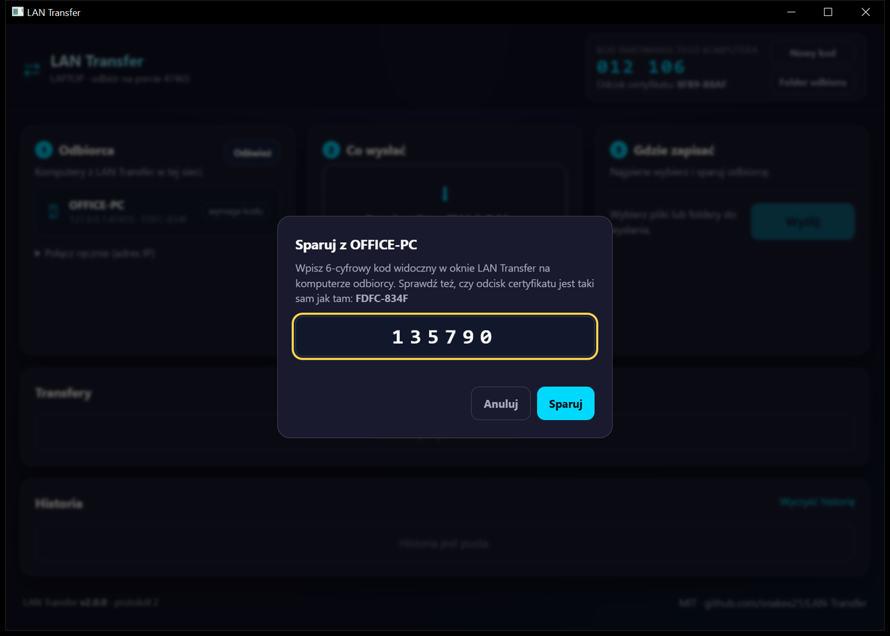

**Languages:** [English](../README.md) · [Polski](README.pl.md) · [Deutsch](README.de.md) · [Français](README.fr.md) · [Español](README.es.md) · [Italiano](README.it.md) · [Português](README.pt.md) · [Nederlands](README.nl.md) · [Svenska](README.sv.md) · [Norsk](README.no.md) · [Dansk](README.da.md) · [Suomi](README.fi.md) · [Čeština](README.cs.md) · [Slovenčina](README.sk.md) · [Magyar](README.hu.md) · [Română](README.ro.md) · [Türkçe](README.tr.md) · [Bahasa Indonesia](README.id.md) · [Bahasa Melayu](README.ms.md) · [Tiếng Việt](README.vi.md) · [Русский](README.ru.md) · [Українська](README.uk.md) · [Български](README.bg.md) · [Ελληνικά](README.el.md) · [العربية](README.ar.md) · [עברית](README.he.md) · [हिन्दी](README.hi.md) · [中文](README.zh.md) · [日本語](README.ja.md) · [한국어](README.ko.md)

# LAN Transfer

[](https://github.com/snakex21/LAN-Transfer/actions/workflows/ci.yml) [](https://github.com/snakex21/LAN-Transfer/releases/latest) [](../LICENSE) [](../go.mod) [](#التنزيل-والتشغيل)

أداة صغيرة محمولة لإرسال الملفات والمجلدات مباشرةً بين جهازي كمبيوتر على الشبكة المحلية نفسها. لا سحابة ولا حساب ولا خادم ترحيل: تنتقل البيانات مباشرةً من جهاز إلى آخر عبر اتصال مشفّر. النواة مكتوبة بلغة Go، مع نافذة WebView2 ونسخة لسطر الأوامر مخصصة للسكربتات.


## المحتويات

- [الميزات](#الميزات)
- [لغة الواجهة](#لغة-الواجهة)
- [لقطات الشاشة](#لقطات-الشاشة)
- [التنزيل والتشغيل](#التنزيل-والتشغيل)
- [كيفية الإقران](#كيفية-الإقران)
- [إرسال الملفات](#إرسال-الملفات)
- [سطر الأوامر](#سطر-الأوامر)
- [المنافذ وجدار الحماية](#المنافذ-وجدار-الحماية)
- [ملاحظات أمنية](#ملاحظات-أمنية)
- [متغيرات البيئة](#متغيرات-البيئة)
- [البناء والاختبارات](#البناء-والاختبارات)
- [الترخيص](#الترخيص)

## الميزات

- اكتشاف تلقائي لأجهزة الكمبيوتر الأخرى التي تشغّل LAN Transfer (بث UDP، مع فحص محدود السرعة للشبكة /24 كخيار احتياطي).
- الإقران برمز مكوّن من 6 أرقام يظهر على جهاز الاستقبال. دون إقران لا يمكن إرسال أي شيء ولا تصفح أي مجلدات.
- تشفير TLS 1.3. يُنشئ كل تشغيل شهادة جديدة موقّعة ذاتيًا؛ وتُثبَّت بصمتها أثناء الإقران ويُتحقق منها عند كل اتصال.
- ملفات ومجلدات كاملة، مع الحفاظ على بنية المجلدات وإرسال ما يصل إلى 4 ملفات بالتوازي.
- استئناف عمليات النقل المنقطعة والتحقق من كل ملف باستخدام SHA-256.
- تُحفظ البيانات غير المكتملة في المجلد المخفي `.lantransfer-partial`، لذلك لا يظهر ملف مبتور أبدًا باسمه النهائي.
- عند تعارض الأسماء يصبح الاسم `file (1).txt` أو `Folder (1)`؛ ولا يُكتب فوق الملفات الموجودة أبدًا.
- تُرفض الأسماء الخطرة (`..`، والمسارات المطلقة، وتدفقات البيانات البديلة `file:stream`، والأسماء المحجوزة مثل `CON` و`NUL` و`COM1`). ويُتحقق من المساحة الحرة على القرص قبل الاستلام.
- السحب والإفلات من مستكشف الملفات، وقائمة انتظار تعرض تقدم كل ملف والسرعة والوقت المتبقي، مع الإلغاء والاستئناف وسجل للعناصر المرسلة والمستلمة.
- محمولة: ملف EXE واحد، والإعدادات والسجل في مجلد `data` بجانبه.
- النافذة وعنوانها ومخرجات سطر الأوامر متاحة بـ 30 لغة (اللغات نفسها التي يتوفر بها هذا الملف README)، وتُختار اللغة تلقائيًا وفق لغة العرض في Windows؛ مع تخطيط من اليمين إلى اليسار للعربية والعبرية.

## لغة الواجهة

يتحدث LAN Transfer اللغات الثلاثين نفسها التي يتوفر بها هذا الملف README. عند التشغيل الأول يستخدم لغة العرض في Windows (أول لغة مدعومة في قائمة لغات Windows)؛ وإذا كان Windows يستخدم لغة غير موجودة في القائمة، فستكون الواجهة باللغة الإنجليزية.

لتغييرها، انقر على زر الترس (**الإعدادات**) أعلى النافذة بجانب رمز الإقران، ثم اختر لغة. تتغير النافذة وعنوانها وجميع الرسائل فورًا، ويُحفظ الاختيار في `data\settings.json`. يعود الخيار **تلقائي (Windows)** إلى اتباع لغة العرض في Windows. تتبع الأرقام والأحجام والسرعات والتواريخ وصيغ الجمع قواعد اللغة المختارة؛ وتستخدم العربية والعبرية تخطيطًا معكوسًا من اليمين إلى اليسار، بينما تبقى المسارات وعناوين IP والرموز والبصمات من اليسار إلى اليمين. تُعرض الرسائل الواردة من الكمبيوتر الآخر (مثل «لا توجد مساحة كافية على قرص المستلِم») بلغتك، لا بلغة جهاز الاستقبال.

يستخدم `LANTransferCLI.exe` اللغة نفسها. ويتجاوز `LANTRANSFER_LANG` (مثلاً `LANTRANSFER_LANG=de`) الاختيار المحفوظ في كل من النافذة وسطر الأوامر.

| English | Deutsch | العربية (RTL) |
|---|---|---|
|  |  |  |

## لقطات الشاشة

| الإقران | الإرسال مع عرض التقدم |
|---|---|
|  |  |
| **الاستئناف بعد الإلغاء** | **جهاز الاستقبال: السجل** |
|  |  |

## التنزيل والتشغيل

1. نزّل `LANTransfer-2.1.0-windows-amd64.zip` من صفحة [Releases](https://github.com/snakex21/LAN-Transfer/releases/latest) وتحقق منه بمقارنته بملف `.sha256` المنشور.
2. فك ضغطه في أي مجلد على كلا الجهازين.
3. شغّل `LANTransfer.exe`. عند التشغيل الأول يطلب Windows (عبر UAC) الإذن بإضافة قاعدتين إلى جدار الحماية؛ راجع [المنافذ وجدار الحماية](#المنافذ-وجدار-الحماية).

المتطلبات: Windows 10 أو 11 (64 بت) مع بيئة تشغيل WebView2، وهي جزء من إصدارات Windows الحالية. يجب أن يعمل الإصدار 2 على كلا الجهازين. لا يمكن للإصدار 2 التواصل مع الإصدار 1.

## كيفية الإقران

1. شغّل LAN Transfer على كلا الجهازين. يعرض جهاز الاستقبال رمز الإقران وبصمة شهادته في أعلى النافذة (في الزاوية العلوية اليسرى عند استخدام الواجهة العربية).
2. على جهاز الإرسال، انقر على جهاز الاستقبال في قائمة **المستلِم**. إذا لم يظهر، فاستخدم **الاتصال يدويًا (عنوان IP)** وأدخل عنوان IP الخاص به.
3. اكتب الرمز المكوّن من 6 أرقام الظاهر على شاشة جهاز الاستقبال، وقارن بصمة الشهادة المعروضة في مربع الحوار بالبصمة الظاهرة على جهاز الاستقبال. إذا اختلفتا، فلا تتابع.
4. انقر على **إقران**. يظهر الجهاز الآن بحالة **✓ مقترن**.

بعد 5 رموز خاطئة من جهاز واحد، يحظر جهاز الاستقبال أي محاولات أخرى منه. ينشئ الزر **رمز جديد** رمزًا جديدًا ويلغي جميع عمليات الإقران الحالية. ينشئ جهاز الاستقبال رمزًا وشهادة جديدين في كل مرة يبدأ فيها، لذا بعد إعادة تشغيل جهاز الاستقبال، قم بالإقران من جديد.

## إرسال الملفات

1. قم بالإقران مع جهاز الاستقبال.
2. اسحب الملفات أو المجلدات إلى النافذة، أو استخدم **اختيار ملفات** / **اختيار مجلد**، أو الصق مسارًا.
3. اختر الوجهة: المجلد الافتراضي لجهاز الاستقبال (`Downloads\LAN Transfer`) أو مجلدًا آخر موجودًا على جهاز الاستقبال.
4. انقر على **إرسال**. يعرض كل عنصر التقدم والسرعة والوقت المتبقي، ويمكن إلغاؤه. يمكن استئناف عملية نقل ملغاة أو منقطعة؛ ولا يُرسل إلا الجزء الناقص.

## سطر الأوامر

`LANTransferCLI.exe` هو البرنامج نفسه دون نافذة، مخصص للسكربتات والأتمتة.

```powershell
LANTransferCLI.exe serve                          # receive; prints the pairing code
LANTransferCLI.exe devices                        # list devices (JSON)
LANTransferCLI.exe send file.zip folder --to 192.168.0.15 --code 123456 [--dest D:\Inbox] [--parallel 4] [--json]
LANTransferCLI.exe version
```

يمكن أيضًا تمرير الرمز عبر `LANTRANSFER_CODE`. ويمكن لجهاز استقبال دون نافذة استخدام رمز ثابت من `LANTRANSFER_PIN`. يؤدي تشغيل أمر `send` نفسه مرة أخرى إلى استئناف عملية النقل المنقطعة.

## المنافذ وجدار الحماية

- UDP 45454: الاكتشاف. TCP 45455: النقل (HTTPS).
- عند التشغيل الأول يطلب التطبيق مرة واحدة (عبر UAC) إضافة قاعدتين للاتصالات الواردة: `LAN Transfer 2 Discovery (UDP)` و`LAN Transfer 2 Transfer (TCP)`.
- لا تقبل القواعد الاتصالات إلا من الشبكة الفرعية المحلية (`remoteip=LocalSubnet`) وفقط على ملفات تعريف الشبكة الخاصة والمجال (`profile=private,domain`). على شبكة يصنّفها Windows على أنها عامة (مقهى، فندق، مطار) لا يمكن لأجهزة الكمبيوتر الأخرى الاتصال بـ LAN Transfer.
- إذا لم يكن جهاز الاستقبال ظاهرًا على شبكتك المنزلية، فتحقق من ضبط الشبكة على أنها خاصة في إعدادات الشبكة في Windows.
- أنشأ الإصدار 1 قواعد باسم `LAN Transfer Discovery` و`LAN Transfer Transfer` لجميع ملفات التعريف، بما فيها العامة. إذا عثر عليها الإصدار 2، فإنه يعرض شريط تنبيه يعرض استبدالها. لا يتغير أي شيء حتى تنقر على **تحديث القواعد** وتؤكد مطالبة Windows.

## ملاحظات أمنية

- الاكتشاف عبر UDP غير موثَّق؛ فهو مجرد تلميح. تأتي الثقة من الإقران: الرمز إضافةً إلى بصمة الشهادة المثبّتة.
- أثناء الإقران الأول، يمكن لمهاجم نشط على الشبكة نفسها (هجوم الوسيط) أن ينتحل صفة جهاز الاستقبال. قارن بصمة الشهادة على كلتا الشاشتين قبل الإقران.
- يمكن للمرسل المقترن تصفح مجلدات جهاز الاستقبال وحفظ الملفات في أي مجلد موجود هناك (خيار الوجهة المخصصة). لا تقرن إلا أجهزة الكمبيوتر التي تثق بها، واستخدم **رمز جديد** لإلغاء جميع عمليات الإقران.
- لا تفتح قواعد جدار الحماية المنافذ على الشبكات المصنّفة على أنها عامة.

## متغيرات البيئة

هذه المتغيرات مخصصة للاختبارات والأتمتة؛ ولا يحتاج الاستخدام العادي إلى أي منها.

| المتغير | المعنى |
|---|---|
| `LANTRANSFER_PORT`, `LANTRANSFER_UDP_PORT` | منافذ أخرى |
| `LANTRANSFER_RECEIVE_DIR`, `LANTRANSFER_DATA_DIR` | مجلد الاستلام، مجلد بيانات البرنامج |
| `LANTRANSFER_NAME` | اسم الكمبيوتر الذي يظهر للآخرين |
| `LANTRANSFER_LANG` | لغة الواجهة وسطر الأوامر (`en`, `de`, `pl`, …)؛ تتجاوز الاختيار المحفوظ |
| `LANTRANSFER_LOOPBACK=1` | 127.0.0.1 فقط: دون بث، ودون فحص LAN، ودون قواعد جدار الحماية |
| `LANTRANSFER_PEER_UDP_PORTS` | منافذ UDP للنسخ الأخرى في وضع loopback |
| `LANTRANSFER_NO_FIREWALL=1` | عدم إنشاء قواعد جدار الحماية أو التحقق منها |
| `LANTRANSFER_PIN`, `LANTRANSFER_CODE` | رمز ثابت لجهاز الاستقبال، الرمز الذي يستخدمه المرسل |

## البناء والاختبارات

Go 1.23 أو أحدث على Windows 10/11.

```powershell
build.bat
go test ./...
python tools/check_i18n.py
```

يشغّل `build.bat` الاختبارات ويبني `LANTransfer.exe` (بنافذة) و`LANTransferCLI.exe` (وحدة التحكم) برقم الإصدار من `VERSION` (الافتراضي `2.1.0`). تشمل الاختبارات عمليات نقل شاملة من طرف إلى طرف عبر 127.0.0.1: الإقران والحظر، ورفض الطلبات غير الموثَّقة، وملفات من 0 B إلى 96 MB، ومجلدات بأسماء Unicode ومسارات تتجاوز 260 حرفًا، وتعارض الأسماء، والأسماء الخبيثة، ومجموع اختباري خاطئ، والإلغاء والاستئناف، والقرص الممتلئ، وتثبيت الشهادة.

توجد الترجمات في `locales/ui.<code>.json` (البولندية هي المصدر، والإنجليزية هي اللغة الاحتياطية). يتحقق `tools/check_i18n.py` من أن الملفات الثلاثين جميعها تحتوي على المفاتيح والعناصر النائبة وصيغ الجمع نفسها وأنها خالية من أي نص بولندي متبقٍّ؛ ويتحقق اختبار Go من وجود كل مفتاح يستخدمه البرنامج في كل لغة.

ملاحظات الإصدار: [docs/releases/v2.1.0.md](../docs/releases/v2.1.0.md) · [v2.0.0](../docs/releases/v2.0.0.md).

## الترخيص

MIT، راجع [LICENSE](../LICENSE).
