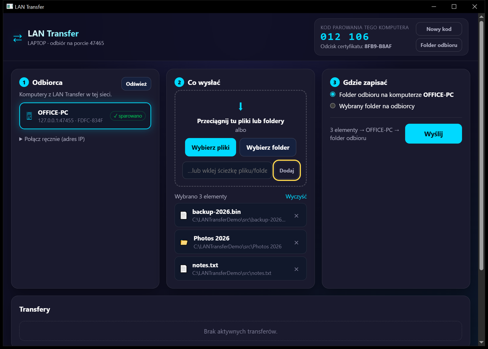

**Languages:** [English](../README.md) · [Polski](README.pl.md) · [Deutsch](README.de.md) · [Français](README.fr.md) · [Español](README.es.md) · [Italiano](README.it.md) · [Português](README.pt.md) · [Nederlands](README.nl.md) · [Svenska](README.sv.md) · [Norsk](README.no.md) · [Dansk](README.da.md) · [Suomi](README.fi.md) · [Čeština](README.cs.md) · [Slovenčina](README.sk.md) · [Magyar](README.hu.md) · [Română](README.ro.md) · [Türkçe](README.tr.md) · [Bahasa Indonesia](README.id.md) · [Bahasa Melayu](README.ms.md) · [Tiếng Việt](README.vi.md) · [Русский](README.ru.md) · [Українська](README.uk.md) · [Български](README.bg.md) · [Ελληνικά](README.el.md) · [العربية](README.ar.md) · [עברית](README.he.md) · [हिन्दी](README.hi.md) · [中文](README.zh.md) · [日本語](README.ja.md) · [한국어](README.ko.md)

# LAN Transfer

[](https://github.com/snakex21/LAN-Transfer/actions/workflows/ci.yml) [](https://github.com/snakex21/LAN-Transfer/releases/latest) [](../LICENSE) [](../go.mod) [](#download-und-start)

Ein kleines portables Werkzeug, um Dateien und Ordner direkt zwischen zwei Computern im selben lokalen Netzwerk zu übertragen. Keine Cloud, kein Konto und kein Relay-Server: Die Daten gehen über eine verschlüsselte Verbindung direkt von einem PC zum anderen. Kern in Go, ein WebView2-Fenster und eine Kommandozeilenversion für Skripte.



## Inhalt

- [Funktionen](#funktionen)
- [Screenshots](#screenshots)
- [Download und Start](#download-und-start)
- [Geräte koppeln](#geräte-koppeln)
- [Dateien senden](#dateien-senden)
- [Kommandozeile](#kommandozeile)
- [Ports und Firewall](#ports-und-firewall)
- [Sicherheitshinweise](#sicherheitshinweise)
- [Umgebungsvariablen](#umgebungsvariablen)
- [Build und Tests](#build-und-tests)
- [Lizenz](#lizenz)

## Funktionen

- Automatische Erkennung anderer Computer, auf denen LAN Transfer läuft (UDP-Broadcast, als Fallback ein gedrosselter Scan des /24-Netzes).
- Kopplung über einen 6-stelligen Code, der auf dem Empfänger angezeigt wird. Ohne Kopplung kann nichts gesendet und kein Ordner durchsucht werden.
- TLS-1.3-Verschlüsselung. Jeder Start erzeugt ein neues selbstsigniertes Zertifikat; sein Fingerabdruck wird beim Koppeln festgelegt (Pinning) und bei jeder Verbindung geprüft.
- Dateien und ganze Ordner, wobei die Ordnerstruktur erhalten bleibt und bis zu 4 Dateien parallel gesendet werden.
- Fortsetzen unterbrochener Übertragungen und SHA-256-Prüfung jeder Datei.
- Unvollständige Daten liegen in einem versteckten Ordner `.lantransfer-partial`, sodass eine abgeschnittene Datei nie unter ihrem endgültigen Namen erscheint.
- Bei Namenskonflikten entsteht `file (1).txt` bzw. `Folder (1)`; vorhandene Dateien werden nie überschrieben.
- Gefährliche Namen werden abgelehnt (`..`, absolute Pfade, alternative Datenströme wie `file:stream`, reservierte Namen wie `CON`, `NUL`, `COM1`). Vor dem Empfang wird der freie Speicherplatz geprüft.
- Drag & Drop aus dem Datei-Explorer, eine Warteschlange mit Fortschritt pro Datei, Geschwindigkeit, Restzeit, Abbrechen, Fortsetzen sowie ein Verlauf gesendeter und empfangener Elemente.
- Portabel: eine einzige EXE-Datei, Einstellungen und Verlauf in einem Ordner `data` daneben.

Die Benutzeroberfläche ist derzeit auf Polnisch.

## Screenshots

| Koppeln | Senden mit Fortschritt |
|---|---|
|  |  |
| **Fortsetzen nach Abbruch** | **Empfänger: Verlauf** |
|  |  |

## Download und Start

1. Laden Sie `LANTransfer-2.0.0-windows-amd64.zip` unter [Releases](https://github.com/snakex21/LAN-Transfer/releases/latest) herunter und prüfen Sie die Datei anhand der veröffentlichten `.sha256`-Datei.
2. Entpacken Sie sie auf beiden Computern in einen beliebigen Ordner.
3. Starten Sie `LANTransfer.exe`. Beim ersten Start fragt Windows (UAC) um Erlaubnis, zwei Firewallregeln hinzuzufügen; siehe [Ports und Firewall](#ports-und-firewall).

Voraussetzungen: Windows 10 oder 11 (64 Bit) mit der WebView2-Runtime, die Bestandteil aktueller Windows-Versionen ist. Auf beiden Computern muss Version 2 laufen. Version 2 kann nicht mit Version 1 kommunizieren.

## Geräte koppeln

1. Starten Sie LAN Transfer auf beiden Computern. Der Empfänger zeigt oben rechts seinen Kopplungscode und den Fingerabdruck seines Zertifikats an.
2. Klicken Sie auf dem sendenden Computer in der Liste **Odbiorca** (Empfänger) auf den Empfänger. Wenn er dort nicht erscheint, verwenden Sie **Połącz ręcznie** (Manuell verbinden) und geben Sie seine IP-Adresse ein.
3. Geben Sie den 6-stelligen Code vom Bildschirm des Empfängers ein und vergleichen Sie den im Dialog angezeigten Zertifikat-Fingerabdruck mit dem auf dem Empfänger. Wenn sie sich unterscheiden, brechen Sie ab.
4. Klicken Sie auf **Sparuj** (Koppeln). Das Gerät wird nun als **sparowano** (gekoppelt) angezeigt.

Nach 5 falschen Codes von einem Computer sperrt der Empfänger weitere Versuche von diesem Computer. **Nowy kod** (Neuer Code) erzeugt einen neuen Code und hebt alle bestehenden Kopplungen auf. Der Empfänger erzeugt bei jedem Start einen neuen Code und ein neues Zertifikat; nach einem Neustart des Empfängers müssen Sie daher erneut koppeln.

## Dateien senden

1. Koppeln Sie sich mit dem Empfänger.
2. Ziehen Sie Dateien oder Ordner in das Fenster, verwenden Sie **Wybierz pliki** / **Wybierz folder** (Dateien auswählen / Ordner auswählen) oder fügen Sie einen Pfad ein.
3. Wählen Sie das Ziel: den Standardordner des Empfängers (`Downloads\LAN Transfer`) oder einen anderen vorhandenen Ordner auf dem Empfänger.
4. Klicken Sie auf **Wyślij** (Senden). Jedes Element zeigt Fortschritt, Geschwindigkeit und Restzeit an und kann abgebrochen werden. Eine abgebrochene oder unterbrochene Übertragung lässt sich fortsetzen; dabei wird nur der fehlende Teil gesendet.

## Kommandozeile

`LANTransferCLI.exe` ist dasselbe Programm ohne Fenster, für Skripte und Automatisierung.

```powershell
LANTransferCLI.exe serve                          # receive; prints the pairing code
LANTransferCLI.exe devices                        # list devices (JSON)
LANTransferCLI.exe send file.zip folder --to 192.168.0.15 --code 123456 [--dest D:\Inbox] [--parallel 4] [--json]
LANTransferCLI.exe version
```

Der Code kann auch über `LANTRANSFER_CODE` übergeben werden. Ein Empfänger ohne Fenster kann einen festen Code aus `LANTRANSFER_PIN` verwenden. Wird derselbe `send`-Befehl erneut ausgeführt, wird eine unterbrochene Übertragung fortgesetzt.

## Ports und Firewall

- UDP 45454: Erkennung. TCP 45455: Übertragung (HTTPS).
- Beim ersten Start fragt die App einmalig (UAC), ob zwei eingehende Regeln hinzugefügt werden dürfen: `LAN Transfer 2 Discovery (UDP)` und `LAN Transfer 2 Transfer (TCP)`.
- Die Regeln akzeptieren Verbindungen nur aus dem lokalen Subnetz (`remoteip=LocalSubnet`) und nur in den Netzwerkprofilen „Privat“ und „Domäne“ (`profile=private,domain`). In einem Netzwerk, das Windows als öffentlich einstuft (Café, Hotel, Flughafen), können andere Computer keine Verbindung zu LAN Transfer herstellen.
- Wenn der Empfänger in Ihrem Heimnetz nicht sichtbar ist, prüfen Sie in den Windows-Netzwerkeinstellungen, ob das Netzwerk als privat eingestellt ist.
- Version 1 hat Regeln namens `LAN Transfer Discovery` und `LAN Transfer Transfer` für alle Profile angelegt, einschließlich „Öffentlich“. Findet Version 2 diese Regeln, zeigt sie ein Banner an, das deren Ersetzung anbietet. Es wird nichts geändert, bevor Sie auf **Zaktualizuj reguły** (Regeln aktualisieren) klicken und die Windows-Abfrage bestätigen.

## Sicherheitshinweise

- Die Erkennung über UDP ist nicht authentifiziert; sie ist nur ein Hinweis. Vertrauen entsteht durch die Kopplung: den Code plus den festgelegten Zertifikat-Fingerabdruck.
- Bei der ersten Kopplung könnte sich ein aktiver Angreifer im selben Netzwerk (Man-in-the-Middle) als Empfänger ausgeben. Vergleichen Sie vor dem Koppeln den Zertifikat-Fingerabdruck auf beiden Bildschirmen.
- Ein gekoppelter Sender kann die Ordner des Empfängers durchsuchen und Dateien in jeden dort vorhandenen Ordner speichern (Option für ein eigenes Ziel). Koppeln Sie nur Computer, denen Sie vertrauen, und verwenden Sie **Nowy kod**, um alle Kopplungen zu widerrufen.
- Die Firewallregeln öffnen die Ports nicht in Netzwerken, die als öffentlich eingestuft sind.

## Umgebungsvariablen

Diese sind für Tests und Automatisierung gedacht; im normalen Betrieb wird keine davon benötigt.

| Variable | Bedeutung |
|---|---|
| `LANTRANSFER_PORT`, `LANTRANSFER_UDP_PORT` | andere Ports |
| `LANTRANSFER_RECEIVE_DIR`, `LANTRANSFER_DATA_DIR` | Empfangsordner, Datenordner des Programms |
| `LANTRANSFER_NAME` | für andere angezeigter Computername |
| `LANTRANSFER_LOOPBACK=1` | nur 127.0.0.1: keine Broadcasts, kein LAN-Scan, keine Firewallregeln |
| `LANTRANSFER_PEER_UDP_PORTS` | UDP-Ports anderer Instanzen im Loopback-Modus |
| `LANTRANSFER_NO_FIREWALL=1` | keine Firewallregeln anlegen oder prüfen |
| `LANTRANSFER_PIN`, `LANTRANSFER_CODE` | fester Code des Empfängers, vom Sender verwendeter Code |

## Build und Tests

Go 1.23 oder neuer unter Windows 10/11.

```powershell
build.bat
go test ./...
```

`build.bat` führt die Tests aus und baut `LANTransfer.exe` (mit Fenster) und `LANTransferCLI.exe` (Konsole) mit der Version aus `VERSION` (Standard `2.0.0`). Die Tests umfassen End-to-End-Übertragungen über 127.0.0.1: Kopplung und Sperre, abgelehnte nicht authentifizierte Anfragen, Dateien von 0 B bis 96 MB, Unicode-Ordner und Pfade mit mehr als 260 Zeichen, Namenskonflikte, bösartige Namen, eine falsche Prüfsumme, Abbrechen und Fortsetzen, eine volle Festplatte sowie Zertifikat-Pinning.

Versionshinweise: [docs/releases/v2.0.0.md](../docs/releases/v2.0.0.md).

## Lizenz

MIT, siehe [LICENSE](../LICENSE).
