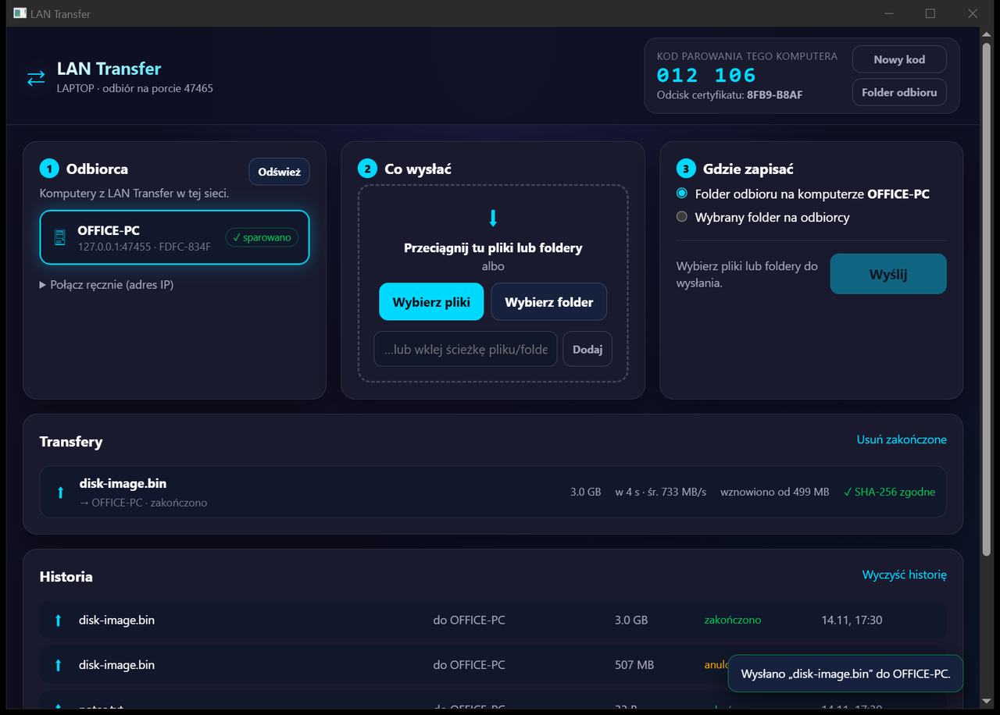

**Languages:** [English](../README.md) · [Polski](README.pl.md) · [Deutsch](README.de.md) · [Français](README.fr.md) · [Español](README.es.md) · [Italiano](README.it.md) · [Português](README.pt.md) · [Nederlands](README.nl.md) · [Svenska](README.sv.md) · [Norsk](README.no.md) · [Dansk](README.da.md) · [Suomi](README.fi.md) · [Čeština](README.cs.md) · [Slovenčina](README.sk.md) · [Magyar](README.hu.md) · [Română](README.ro.md) · [Türkçe](README.tr.md) · [Bahasa Indonesia](README.id.md) · [Bahasa Melayu](README.ms.md) · [Tiếng Việt](README.vi.md) · [Русский](README.ru.md) · [Українська](README.uk.md) · [Български](README.bg.md) · [Ελληνικά](README.el.md) · [العربية](README.ar.md) · [עברית](README.he.md) · [हिन्दी](README.hi.md) · [中文](README.zh.md) · [日本語](README.ja.md) · [한국어](README.ko.md)

# LAN Transfer

[](https://github.com/snakex21/LAN-Transfer/actions/workflows/ci.yml) [](https://github.com/snakex21/LAN-Transfer/releases/latest) [](../LICENSE) [](../go.mod) [](#ダウンロードと実行)

同じローカルネットワーク上の 2 台のコンピューター間で、ファイルやフォルダーを直接送信するための小さなポータブルツールです。クラウドもアカウントも中継サーバーも不要で、データは暗号化された接続を通じて一方の PC からもう一方へ直接送られます。コアは Go で書かれており、WebView2 のウィンドウと、スクリプト向けのコマンドライン版を備えています。


## 目次

- [機能](#機能)
- [インターフェイスの言語](#インターフェイスの言語)
- [スクリーンショット](#スクリーンショット)
- [ダウンロードと実行](#ダウンロードと実行)
- [ペアリング方法](#ペアリング方法)
- [ファイルの送信](#ファイルの送信)
- [コマンドライン](#コマンドライン)
- [ポートとファイアウォール](#ポートとファイアウォール)
- [セキュリティに関する注意](#セキュリティに関する注意)
- [環境変数](#環境変数)
- [ビルドとテスト](#ビルドとテスト)
- [ライセンス](#ライセンス)

## 機能

- LAN Transfer を実行している他のコンピューターを自動検出します（UDP ブロードキャスト。フォールバックとして速度を抑えた /24 スキャンを使用）。
- 受信側に表示される 6 桁のコードでペアリングします。ペアリングしなければ、何も送信できず、フォルダーを参照することもできません。
- TLS 1.3 による暗号化。起動のたびに新しい自己署名証明書が作成され、そのフィンガープリントはペアリング時に固定（ピン留め）され、接続のたびに検証されます。
- ファイルとフォルダー全体に対応し、フォルダー構造を保持したまま、最大 4 ファイルを並列で送信します。
- 中断された転送の再開と、すべてのファイルの SHA-256 チェック。
- 未完了のデータは隠しフォルダー `.lantransfer-partial` に保存されるため、途中で切れたファイルが最終的な名前で現れることはありません。
- 名前が重複した場合は `file (1).txt` や `Folder (1)` になり、既存のファイルが上書きされることはありません。
- 危険な名前は拒否されます（`..`、絶対パス、`file:stream` 形式の代替データストリーム、`CON`、`NUL`、`COM1` などの予約名）。受信前にディスクの空き容量を確認します。
- エクスプローラーからのドラッグ＆ドロップ、ファイルごとの進捗・速度・残り時間を表示するキュー、キャンセル、再開、送受信した項目の履歴。
- ポータブル：EXE ファイル 1 つだけで、設定と履歴はその隣の `data` フォルダーに保存されます。
- ウィンドウ、そのタイトル、コマンドラインの出力は 30 言語（この README と同じ）に対応し、Windows の表示言語に基づいて自動的に選択されます。アラビア語とヘブライ語では右から左へのレイアウトになります。

## インターフェイスの言語

LAN Transfer は、この README と同じ 30 言語に対応しています。初回起動時は Windows の表示言語（Windows の言語一覧で最初にあるサポート対象の言語）を使用します。Windows の言語が一覧にない場合、インターフェイスは英語で表示されます。

変更するには、右上隅の歯車ボタン（**設定**）をクリックして言語を選択します。ウィンドウ、そのタイトル、すべてのメッセージがすぐに切り替わり、選択内容は `data\settings.json` に保存されます。**自動（Windows）** を選ぶと、再び Windows の表示言語に従います。数値、サイズ、速度、日付、複数形は選択した言語の規則に従います。アラビア語とヘブライ語では左右を反転した右から左へのレイアウトになりますが、パス、IP アドレス、コード、フィンガープリントは左から右のままです。相手のコンピューターからのメッセージ（たとえば「受信側のディスクの空き領域が不足しています」）も、受信側の言語ではなく、あなたの言語で表示されます。

`LANTransferCLI.exe` も同じ言語を使用します。`LANTRANSFER_LANG`（例：`LANTRANSFER_LANG=de`）を設定すると、ウィンドウとコマンドラインの両方で、保存された選択よりも優先されます。

| English | Deutsch | العربية (RTL) |
|---|---|---|
|  |  |  |

## スクリーンショット

| ペアリング | 進捗付きの送信 |
|---|---|
|  |  |
| **キャンセル後の再開** | **受信側：履歴** |
|  |  |

## ダウンロードと実行

1. [Releases](https://github.com/snakex21/LAN-Transfer/releases/latest) から `LANTransfer-2.1.0-windows-amd64.zip` をダウンロードし、公開されている `.sha256` ファイルと照合して確認します。
2. 両方のコンピューターで、任意のフォルダーに展開します。
3. `LANTransfer.exe` を起動します。初回起動時に、Windows が 2 つのファイアウォール規則を追加する許可を（UAC で）求めます。詳しくは[ポートとファイアウォール](#ポートとファイアウォール)を参照してください。

動作要件：WebView2 ランタイムを備えた Windows 10 または 11（64 ビット）。WebView2 は現在の Windows に含まれています。両方のコンピューターでバージョン 2 を実行する必要があります。バージョン 2 はバージョン 1 と通信できません。

## ペアリング方法

1. 両方のコンピューターで LAN Transfer を起動します。受信側の右上隅に、ペアリングコードと証明書のフィンガープリントが表示されます。
2. 送信側のコンピューターで、**受信側** 一覧から受信側をクリックします。表示されない場合は、**手動で接続（IP アドレス）** を使用して IP アドレスを入力します。
3. 受信側の画面に表示されている 6 桁のコードを入力し、ダイアログに表示された証明書のフィンガープリントを受信側のものと比較します。一致しない場合は、先に進まないでください。
4. **ペアリング** をクリックします。デバイスに **✓ ペアリング済み** と表示されます。

同じコンピューターから誤ったコードが 5 回入力されると、受信側はそのコンピューターからのそれ以降の試行をブロックします。**新しいコード** は新しいコードを作成し、既存のペアリングをすべて取り消します。受信側は起動するたびに新しいコードと証明書を作成するため、受信側を再起動した後はもう一度ペアリングしてください。

## ファイルの送信

1. 受信側とペアリングします。
2. ファイルやフォルダーをウィンドウにドラッグするか、**ファイルを選択** / **フォルダーを選択** を使用するか、パスを貼り付けます。
3. 送信先を選択します。受信側の既定のフォルダー（`Downloads\LAN Transfer`）か、受信側にある別の既存フォルダーを指定できます。
4. **送信** をクリックします。各項目には進捗、速度、残り時間が表示され、キャンセルできます。キャンセルまたは中断された転送は再開でき、不足している部分だけが送信されます。

## コマンドライン

`LANTransferCLI.exe` はウィンドウのない同じプログラムで、スクリプトや自動化に使用します。

```powershell
LANTransferCLI.exe serve                          # receive; prints the pairing code
LANTransferCLI.exe devices                        # list devices (JSON)
LANTransferCLI.exe send file.zip folder --to 192.168.0.15 --code 123456 [--dest D:\Inbox] [--parallel 4] [--json]
LANTransferCLI.exe version
```

コードは `LANTRANSFER_CODE` で渡すこともできます。ウィンドウのない受信側は、`LANTRANSFER_PIN` の固定コードを使用できます。同じ `send` コマンドを再度実行すると、中断された転送が再開されます。

## ポートとファイアウォール

- UDP 45454：検出。TCP 45455：転送（HTTPS）。
- 初回起動時に、アプリは 2 つの受信規則 `LAN Transfer 2 Discovery (UDP)` と `LAN Transfer 2 Transfer (TCP)` を追加するため、一度だけ（UAC で）確認を求めます。
- これらの規則は、ローカルサブネットからの接続のみ（`remoteip=LocalSubnet`）、かつプライベートとドメインのネットワークプロファイルでのみ（`profile=private,domain`）受け入れます。Windows がパブリックとして扱うネットワーク（カフェ、ホテル、空港）では、他のコンピューターは LAN Transfer に接続できません。
- 自宅のネットワークで受信側が表示されない場合は、Windows のネットワーク設定でそのネットワークがプライベートに設定されていることを確認してください。
- バージョン 1 は、パブリックを含むすべてのプロファイルを対象に `LAN Transfer Discovery` と `LAN Transfer Transfer` という名前の規則を作成していました。バージョン 2 がこれらを見つけると、置き換えを提案するバナーを表示します。**規則を更新** をクリックして Windows の確認プロンプトを承認するまで、何も変更されません。

## セキュリティに関する注意

- UDP による検出は認証されておらず、あくまで手がかりにすぎません。信頼はペアリングによって確立されます。つまり、コードと固定された証明書のフィンガープリントです。
- 最初のペアリング中に、同じネットワーク上の能動的な攻撃者（中間者）が受信側になりすます可能性があります。ペアリングの前に、両方の画面で証明書のフィンガープリントを比較してください。
- ペアリング済みの送信側は、受信側のフォルダーを参照し、そこにある任意の既存フォルダーにファイルを保存できます（カスタム送信先オプション）。信頼できるコンピューターとのみペアリングし、すべてのペアリングを取り消すには **新しいコード** を使用してください。
- パブリックとしてマークされたネットワークでは、ファイアウォール規則はポートを開放しません。

## 環境変数

これらはテストと自動化を目的としたもので、通常の使用ではいずれも必要ありません。

| 変数 | 意味 |
|---|---|
| `LANTRANSFER_PORT`, `LANTRANSFER_UDP_PORT` | 別のポート |
| `LANTRANSFER_RECEIVE_DIR`, `LANTRANSFER_DATA_DIR` | 受信フォルダー、プログラムのデータフォルダー |
| `LANTRANSFER_NAME` | 他のコンピューターに表示されるコンピューター名 |
| `LANTRANSFER_LANG` | インターフェイスと CLI の言語（`en`、`de`、`pl` など）。保存された選択よりも優先されます |
| `LANTRANSFER_LOOPBACK=1` | 127.0.0.1 のみ：ブロードキャストなし、LAN スキャンなし、ファイアウォール規則なし |
| `LANTRANSFER_PEER_UDP_PORTS` | ループバックモードでの他のインスタンスの UDP ポート |
| `LANTRANSFER_NO_FIREWALL=1` | ファイアウォール規則を作成も確認もしない |
| `LANTRANSFER_PIN`, `LANTRANSFER_CODE` | 受信側の固定コード、送信側が使用するコード |

## ビルドとテスト

Windows 10/11 上の Go 1.23 以降。

```powershell
build.bat
go test ./...
python tools/check_i18n.py
```

`build.bat` はテストを実行し、`VERSION` のバージョン（既定値 `2.1.0`）で `LANTransfer.exe`（ウィンドウ版）と `LANTransferCLI.exe`（コンソール版）をビルドします。テストには 127.0.0.1 を介したエンドツーエンドの転送が含まれます：ペアリングとロックアウト、認証されていない要求の拒否、0 B から 96 MB までのファイル、Unicode のフォルダーと 260 文字を超えるパス、名前の重複、悪意のある名前、誤ったチェックサム、キャンセルと再開、ディスクの空き容量不足、証明書のピン留め。

翻訳は `locales/ui.<code>.json` にあります（ポーランド語が原文、英語がフォールバック）。`tools/check_i18n.py` は、30 個すべてのファイルでキー、プレースホルダー、複数形が一致し、ポーランド語が残っていないことを確認します。さらに Go のテストで、プログラムが使用するすべてのキーがすべての言語に存在することを確認します。

リリースノート：[docs/releases/v2.1.0.md](../docs/releases/v2.1.0.md) · [v2.0.0](../docs/releases/v2.0.0.md)。

## ライセンス

MIT。[LICENSE](../LICENSE) を参照してください。
