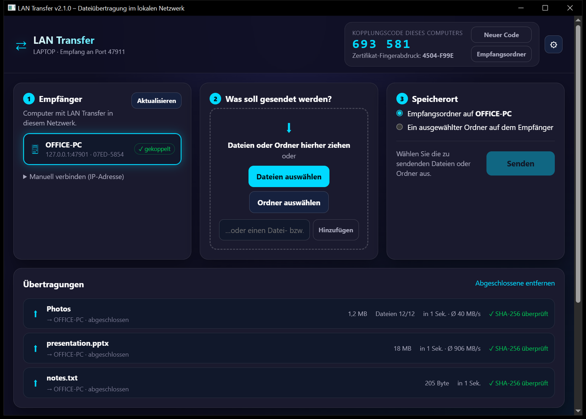

**Languages:** [English](../README.md) · [Polski](README.pl.md) · [Deutsch](README.de.md) · [Français](README.fr.md) · [Español](README.es.md) · [Italiano](README.it.md) · [Português](README.pt.md) · [Nederlands](README.nl.md) · [Svenska](README.sv.md) · [Norsk](README.no.md) · [Dansk](README.da.md) · [Suomi](README.fi.md) · [Čeština](README.cs.md) · [Slovenčina](README.sk.md) · [Magyar](README.hu.md) · [Română](README.ro.md) · [Türkçe](README.tr.md) · [Bahasa Indonesia](README.id.md) · [Bahasa Melayu](README.ms.md) · [Tiếng Việt](README.vi.md) · [Русский](README.ru.md) · [Українська](README.uk.md) · [Български](README.bg.md) · [Ελληνικά](README.el.md) · [العربية](README.ar.md) · [עברית](README.he.md) · [हिन्दी](README.hi.md) · [中文](README.zh.md) · [日本語](README.ja.md) · [한국어](README.ko.md)

# LAN Transfer

[](https://github.com/snakex21/LAN-Transfer/actions/workflows/ci.yml) [](https://github.com/snakex21/LAN-Transfer/releases/latest) [](../LICENSE) [](../go.mod) [](#muat-turun-dan-jalankan)

Alat mudah alih yang kecil untuk menghantar fail dan folder secara terus antara dua komputer dalam rangkaian setempat yang sama. Tiada awan, tiada akaun dan tiada pelayan perantara: data dihantar terus dari satu PC ke PC yang lain melalui sambungan yang disulitkan. Teras dalam Go, tetingkap WebView2 dan versi baris perintah untuk skrip.


## Kandungan

- [Ciri-ciri](#ciri-ciri)
- [Bahasa antara muka](#bahasa-antara-muka)
- [Tangkapan skrin](#tangkapan-skrin)
- [Muat turun dan jalankan](#muat-turun-dan-jalankan)
- [Cara menggandingkan](#cara-menggandingkan)
- [Menghantar fail](#menghantar-fail)
- [Baris perintah](#baris-perintah)
- [Port dan tembok api](#port-dan-tembok-api)
- [Nota keselamatan](#nota-keselamatan)
- [Pemboleh ubah persekitaran](#pemboleh-ubah-persekitaran)
- [Binaan dan ujian](#binaan-dan-ujian)
- [Lesen](#lesen)

## Ciri-ciri

- Penemuan automatik komputer lain yang menjalankan LAN Transfer (UDP broadcast, dengan imbasan /24 yang dihadkan kelajuannya sebagai sandaran).
- Penggandingan dengan kod 6 digit yang dipaparkan pada penerima. Tanpa penggandingan, tiada apa-apa boleh dihantar dan tiada folder boleh disemak imbas.
- Penyulitan TLS 1.3. Setiap kali dijalankan, sijil tandatangan sendiri (self-signed) yang baharu dicipta; cap jarinya disematkan (pinned) semasa penggandingan dan disemak pada setiap sambungan.
- Fail dan keseluruhan folder, dengan struktur folder dikekalkan dan sehingga 4 fail dihantar secara selari.
- Penyambungan semula pemindahan yang terganggu dan semakan SHA-256 bagi setiap fail.
- Data yang belum selesai disimpan dalam folder tersembunyi `.lantransfer-partial`, jadi fail yang terpotong tidak akan muncul dengan nama akhirnya.
- Pertembungan nama menjadi `file (1).txt` atau `Folder (1)`; fail sedia ada tidak akan sekali-kali ditulis ganti.
- Nama berbahaya ditolak (`..`, laluan mutlak, aliran data alternatif `file:stream`, nama terpelihara seperti `CON`, `NUL`, `COM1`). Ruang cakera kosong disemak sebelum menerima.
- Seret dan lepas dari Explorer, baris gilir dengan kemajuan bagi setiap fail, kelajuan, baki masa, pembatalan, penyambungan semula dan sejarah item yang dihantar serta diterima.
- Mudah alih: satu fail EXE, tetapan dan sejarah dalam folder `data` di sebelahnya.
- Tetingkap, tajuknya dan output baris perintah dalam 30 bahasa (sama seperti README ini), dipilih secara automatik berdasarkan bahasa paparan Windows; susun atur kanan ke kiri untuk bahasa Arab dan Ibrani.

## Bahasa antara muka

LAN Transfer menggunakan 30 bahasa yang sama seperti README ini. Pada permulaan pertama, ia menggunakan bahasa paparan Windows (bahasa pertama yang disokong dalam senarai bahasa Windows); jika Windows menggunakan bahasa yang tiada dalam senarai, antara muka dipaparkan dalam bahasa Inggeris.

Untuk menukarnya, klik butang gear (**Tetapan**) di penjuru kanan atas dan pilih bahasa. Tetingkap, tajuknya dan semua mesej bertukar serta-merta, dan pilihan anda disimpan dalam `data\settings.json`. **Automatik (Windows)** kembali mengikut bahasa paparan Windows. Nombor, saiz, kelajuan, tarikh dan bentuk jamak mengikut peraturan bahasa yang dipilih; bahasa Arab dan Ibrani menggunakan susun atur cermin dari kanan ke kiri, manakala laluan, alamat IP, kod dan cap jari kekal dari kiri ke kanan. Mesej daripada komputer lain (contohnya “ruang tidak mencukupi pada cakera penerima”) dipaparkan dalam bahasa anda, bukan dalam bahasa penerima.

`LANTransferCLI.exe` menggunakan bahasa yang sama. `LANTRANSFER_LANG` (contohnya `LANTRANSFER_LANG=de`) mengatasi pilihan yang disimpan, baik untuk tetingkap mahupun baris perintah.

| English | Deutsch | العربية (RTL) |
|---|---|---|
|  |  |  |

## Tangkapan skrin

| Penggandingan | Penghantaran dengan kemajuan |
|---|---|
|  |  |
| **Sambung semula selepas dibatalkan** | **Penerima: sejarah** |
|  |  |

## Muat turun dan jalankan

1. Muat turun `LANTransfer-2.1.0-windows-amd64.zip` dari [Releases](https://github.com/snakex21/LAN-Transfer/releases/latest) dan semak dengan fail `.sha256` yang diterbitkan.
2. Ekstrak ke mana-mana folder pada kedua-dua komputer.
3. Mulakan `LANTransfer.exe`. Pada permulaan pertama, Windows meminta kebenaran (UAC) untuk menambah dua peraturan tembok api; lihat [Port dan tembok api](#port-dan-tembok-api).

Keperluan: Windows 10 atau 11 (64-bit) dengan masa jalan WebView2, yang merupakan sebahagian daripada Windows semasa. Kedua-dua komputer mesti menjalankan versi 2. Versi 2 tidak boleh berkomunikasi dengan versi 1.

## Cara menggandingkan

1. Mulakan LAN Transfer pada kedua-dua komputer. Penerima memaparkan kod penggandingan dan cap jari sijilnya di penjuru kanan atas.
2. Pada komputer penghantar, klik penerima dalam senarai **Penerima**. Jika ia tidak muncul, gunakan **Sambung secara manual (alamat IP)** dan masukkan alamat IP-nya.
3. Taip kod 6 digit dari skrin penerima dan bandingkan cap jari sijil yang dipaparkan dalam dialog dengan cap jari pada penerima. Jika berbeza, jangan teruskan.
4. Klik **Gandingkan**. Peranti kini memaparkan **✓ digandingkan**.

Selepas 5 kod salah daripada satu komputer, penerima menyekat percubaan seterusnya daripada komputer itu. **Kod baharu** mencipta kod baharu dan membatalkan semua penggandingan sedia ada. Penerima mencipta kod dan sijil baharu setiap kali ia dimulakan, jadi selepas penerima dimulakan semula, gandingkan sekali lagi.

## Menghantar fail

1. Gandingkan dengan penerima.
2. Seret fail atau folder ke tetingkap, gunakan **Pilih fail** / **Pilih folder**, atau tampal laluan.
3. Pilih destinasi: folder lalai penerima (`Downloads\LAN Transfer`) atau folder lain yang sedia ada pada penerima.
4. Klik **Hantar**. Setiap item memaparkan kemajuan, kelajuan dan baki masa serta boleh dibatalkan. Pemindahan yang dibatalkan atau terganggu boleh disambung semula; hanya bahagian yang tertinggal akan dihantar.

## Baris perintah

`LANTransferCLI.exe` ialah program yang sama tanpa tetingkap, untuk skrip dan automasi.

```powershell
LANTransferCLI.exe serve                          # receive; prints the pairing code
LANTransferCLI.exe devices                        # list devices (JSON)
LANTransferCLI.exe send file.zip folder --to 192.168.0.15 --code 123456 [--dest D:\Inbox] [--parallel 4] [--json]
LANTransferCLI.exe version
```

Kod juga boleh dihantar melalui `LANTRANSFER_CODE`. Penerima tanpa tetingkap boleh menggunakan kod tetap daripada `LANTRANSFER_PIN`. Menjalankan semula perintah `send` yang sama akan menyambung semula pemindahan yang terganggu.

## Port dan tembok api

- UDP 45454: penemuan. TCP 45455: pemindahan (HTTPS).
- Pada permulaan pertama, aplikasi meminta sekali (UAC) untuk menambah dua peraturan masuk: `LAN Transfer 2 Discovery (UDP)` dan `LAN Transfer 2 Transfer (TCP)`.
- Peraturan ini hanya menerima sambungan daripada subnet setempat (`remoteip=LocalSubnet`) dan hanya pada profil rangkaian Peribadi dan Domain (`profile=private,domain`). Pada rangkaian yang ditandakan oleh Windows sebagai Awam (kafe, hotel, lapangan terbang), komputer lain tidak boleh menyambung ke LAN Transfer.
- Jika penerima tidak kelihatan dalam rangkaian rumah anda, pastikan rangkaian itu ditetapkan sebagai Peribadi dalam tetapan rangkaian Windows.
- Versi 1 mencipta peraturan bernama `LAN Transfer Discovery` dan `LAN Transfer Transfer` untuk semua profil, termasuk Awam. Jika versi 2 menemuinya, ia memaparkan sepanduk yang menawarkan untuk menggantikannya. Tiada apa-apa diubah sehingga anda mengklik **Kemas kini peraturan** dan mengesahkan gesaan Windows.

## Nota keselamatan

- Penemuan melalui UDP tidak disahkan; ia hanya petunjuk. Kepercayaan datang daripada penggandingan: kod serta cap jari sijil yang disematkan.
- Semasa penggandingan pertama, penyerang aktif dalam rangkaian yang sama (man in the middle) boleh menyamar sebagai penerima. Bandingkan cap jari sijil pada kedua-dua skrin sebelum menggandingkan.
- Penghantar yang telah digandingkan boleh menyemak imbas folder penerima dan menyimpan fail ke dalam mana-mana folder sedia ada di sana (pilihan destinasi tersuai). Gandingkan hanya komputer yang anda percayai, dan gunakan **Kod baharu** untuk membatalkan semua penggandingan.
- Peraturan tembok api tidak membuka port pada rangkaian yang ditandakan sebagai Awam.

## Pemboleh ubah persekitaran

Ini bertujuan untuk ujian dan automasi; penggunaan biasa tidak memerlukan mana-mana daripadanya.

| Pemboleh ubah | Maksud |
|---|---|
| `LANTRANSFER_PORT`, `LANTRANSFER_UDP_PORT` | port lain |
| `LANTRANSFER_RECEIVE_DIR`, `LANTRANSFER_DATA_DIR` | folder penerimaan, folder data program |
| `LANTRANSFER_NAME` | nama komputer yang dipaparkan kepada orang lain |
| `LANTRANSFER_LANG` | bahasa antara muka dan CLI (`en`, `de`, `pl`, …); mengatasi pilihan yang disimpan |
| `LANTRANSFER_LOOPBACK=1` | 127.0.0.1 sahaja: tiada siaran, tiada imbasan LAN, tiada peraturan tembok api |
| `LANTRANSFER_PEER_UDP_PORTS` | port UDP bagi tika lain dalam mod loopback |
| `LANTRANSFER_NO_FIREWALL=1` | jangan cipta atau semak peraturan tembok api |
| `LANTRANSFER_PIN`, `LANTRANSFER_CODE` | kod tetap penerima, kod yang digunakan oleh penghantar |

## Binaan dan ujian

Go 1.23 atau lebih baharu pada Windows 10/11.

```powershell
build.bat
go test ./...
python tools/check_i18n.py
```

`build.bat` menjalankan ujian dan membina `LANTransfer.exe` (tetingkap) dan `LANTransferCLI.exe` (konsol) dengan versi daripada `VERSION` (lalai `2.1.0`). Ujian merangkumi pemindahan hujung ke hujung melalui 127.0.0.1: penggandingan dan penyekatan, permintaan tidak disahkan yang ditolak, fail dari 0 B hingga 96 MB, folder Unicode dan laluan melebihi 260 aksara, pertembungan nama, nama berniat jahat, checksum yang salah, pembatalan dan penyambungan semula, cakera penuh serta penyematan sijil.

Terjemahan disimpan dalam `locales/ui.<code>.json` (bahasa Poland ialah sumber, bahasa Inggeris ialah sandaran). `tools/check_i18n.py` menyemak bahawa kesemua 30 fail mempunyai kunci, pemegang tempat dan bentuk jamak yang sama serta tiada teks bahasa Poland yang tertinggal; ujian Go pula menyemak bahawa setiap kunci yang digunakan oleh program wujud dalam setiap bahasa.

Nota keluaran: [docs/releases/v2.1.0.md](../docs/releases/v2.1.0.md) · [v2.0.0](../docs/releases/v2.0.0.md).

## Lesen

MIT, lihat [LICENSE](../LICENSE).
