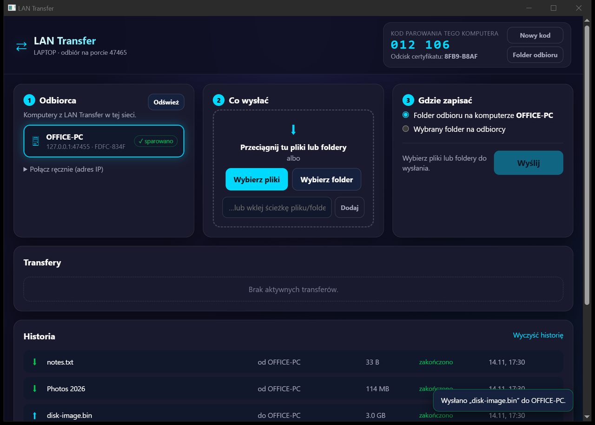

**Languages:** [English](../README.md) · [Polski](README.pl.md) · [Deutsch](README.de.md) · [Français](README.fr.md) · [Español](README.es.md) · [Italiano](README.it.md) · [Português](README.pt.md) · [Nederlands](README.nl.md) · [Svenska](README.sv.md) · [Norsk](README.no.md) · [Dansk](README.da.md) · [Suomi](README.fi.md) · [Čeština](README.cs.md) · [Slovenčina](README.sk.md) · [Magyar](README.hu.md) · [Română](README.ro.md) · [Türkçe](README.tr.md) · [Bahasa Indonesia](README.id.md) · [Bahasa Melayu](README.ms.md) · [Tiếng Việt](README.vi.md) · [Русский](README.ru.md) · [Українська](README.uk.md) · [Български](README.bg.md) · [Ελληνικά](README.el.md) · [العربية](README.ar.md) · [עברית](README.he.md) · [हिन्दी](README.hi.md) · [中文](README.zh.md) · [日本語](README.ja.md) · [한국어](README.ko.md)

# LAN Transfer

[](https://github.com/snakex21/LAN-Transfer/actions/workflows/ci.yml) [](https://github.com/snakex21/LAN-Transfer/releases/latest) [](../LICENSE) [](../go.mod) [](#downloaden-en-starten)

Een kleine, draagbare tool om bestanden en mappen rechtstreeks tussen twee computers in hetzelfde lokale netwerk te versturen. Geen cloud, geen account en geen relayserver: de gegevens gaan via een versleutelde verbinding direct van de ene pc naar de andere. Een kern in Go, een WebView2-venster en een opdrachtregelversie voor scripts.


## Inhoud

- [Functies](#functies)
- [Schermafbeeldingen](#schermafbeeldingen)
- [Downloaden en starten](#downloaden-en-starten)
- [Hoe te koppelen](#hoe-te-koppelen)
- [Bestanden verzenden](#bestanden-verzenden)
- [Opdrachtregel](#opdrachtregel)
- [Poorten en firewall](#poorten-en-firewall)
- [Opmerkingen over beveiliging](#opmerkingen-over-beveiliging)
- [Omgevingsvariabelen](#omgevingsvariabelen)
- [Bouwen en tests](#bouwen-en-tests)
- [Licentie](#licentie)

## Functies

- Automatische detectie van andere computers waarop LAN Transfer draait (UDP-broadcast, met een gedoseerde /24-scan als terugvaloptie).
- Koppelen met een 6-cijferige code die op de ontvanger wordt getoond. Zonder koppeling kan er niets worden verzonden en kunnen er geen mappen worden doorzocht.
- TLS 1.3-versleuteling. Bij elke start wordt een nieuw zelfondertekend certificaat aangemaakt; de vingerafdruk ervan wordt tijdens het koppelen vastgelegd (pinning) en bij elke verbinding gecontroleerd.
- Bestanden en complete mappen, met behoud van de mapstructuur en tot 4 bestanden tegelijk.
- Hervatten van onderbroken overdrachten en een SHA-256-controle van elk bestand.
- Onvoltooide gegevens worden bewaard in een verborgen map `.lantransfer-partial`, zodat een afgekapt bestand nooit onder zijn definitieve naam verschijnt.
- Bij naamconflicten ontstaat `file (1).txt` of `Folder (1)`; bestaande bestanden worden nooit overschreven.
- Gevaarlijke namen worden geweigerd (`..`, absolute paden, alternatieve gegevensstromen `file:stream`, gereserveerde namen zoals `CON`, `NUL`, `COM1`). Vóór het ontvangen wordt de vrije schijfruimte gecontroleerd.
- Slepen en neerzetten vanuit Verkenner, een wachtrij met voortgang per bestand, snelheid, resterende tijd, annuleren, hervatten en een geschiedenis van verzonden en ontvangen items.
- Draagbaar: één EXE-bestand, met instellingen en geschiedenis in een map `data` ernaast.

De gebruikersinterface is momenteel in het Pools.

## Schermafbeeldingen

| Koppelen | Verzenden met voortgang |
|---|---|
|  |  |
| **Hervatten na annuleren** | **Ontvanger: geschiedenis** |
|  |  |

## Downloaden en starten

1. Download `LANTransfer-2.0.0-windows-amd64.zip` via [Releases](https://github.com/snakex21/LAN-Transfer/releases/latest) en controleer het aan de hand van het gepubliceerde `.sha256`-bestand.
2. Pak het op beide computers uit in een willekeurige map.
3. Start `LANTransfer.exe`. Bij de eerste start vraagt Windows (UAC) toestemming om twee firewallregels toe te voegen; zie [Poorten en firewall](#poorten-en-firewall).

Vereisten: Windows 10 of 11 (64-bit) met de WebView2-runtime, die deel uitmaakt van actuele Windows-versies. Op beide computers moet versie 2 draaien. Versie 2 kan niet communiceren met versie 1.

## Hoe te koppelen

1. Start LAN Transfer op beide computers. De ontvanger toont rechtsboven zijn koppelcode en de vingerafdruk van zijn certificaat.
2. Klik op de verzendende computer op de ontvanger in de lijst **Odbiorca** (Ontvanger). Verschijnt hij niet, gebruik dan **Połącz ręcznie** (Handmatig verbinden) en voer zijn IP-adres in.
3. Typ de 6-cijferige code van het scherm van de ontvanger en vergelijk de vingerafdruk van het certificaat in het dialoogvenster met die op de ontvanger. Als ze verschillen, ga dan niet verder.
4. Klik op **Sparuj** (Koppelen). Het apparaat toont nu **sparowano** (gekoppeld).

Na 5 foute codes vanaf één computer blokkeert de ontvanger verdere pogingen vanaf die computer. **Nowy kod** (Nieuwe code) maakt een nieuwe code aan en annuleert alle bestaande koppelingen. De ontvanger maakt bij elke start een nieuwe code en een nieuw certificaat aan; koppel dus opnieuw nadat de ontvanger opnieuw is gestart.

## Bestanden verzenden

1. Koppel met de ontvanger.
2. Sleep bestanden of mappen naar het venster, gebruik **Wybierz pliki** / **Wybierz folder** (Bestanden kiezen / Map kiezen) of plak een pad.
3. Kies de bestemming: de standaardmap van de ontvanger (`Downloads\LAN Transfer`) of een andere bestaande map op de ontvanger.
4. Klik op **Wyślij** (Verzenden). Elk item toont voortgang, snelheid en resterende tijd en kan worden geannuleerd. Een geannuleerde of onderbroken overdracht kan worden hervat; alleen het ontbrekende deel wordt verzonden.

## Opdrachtregel

`LANTransferCLI.exe` is hetzelfde programma zonder venster, voor scripts en automatisering.

```powershell
LANTransferCLI.exe serve                          # receive; prints the pairing code
LANTransferCLI.exe devices                        # list devices (JSON)
LANTransferCLI.exe send file.zip folder --to 192.168.0.15 --code 123456 [--dest D:\Inbox] [--parallel 4] [--json]
LANTransferCLI.exe version
```

De code kan ook worden doorgegeven via `LANTRANSFER_CODE`. Een ontvanger zonder venster kan een vaste code uit `LANTRANSFER_PIN` gebruiken. Door hetzelfde `send`-commando opnieuw uit te voeren, wordt een onderbroken overdracht hervat.

## Poorten en firewall

- UDP 45454: detectie. TCP 45455: overdracht (HTTPS).
- Bij de eerste start vraagt de app eenmalig (UAC) om twee inkomende regels toe te voegen: `LAN Transfer 2 Discovery (UDP)` en `LAN Transfer 2 Transfer (TCP)`.
- De regels accepteren alleen verbindingen vanuit het lokale subnet (`remoteip=LocalSubnet`) en alleen op de netwerkprofielen Privé en Domein (`profile=private,domain`). Op een netwerk dat Windows als Openbaar markeert (café, hotel, luchthaven) kunnen andere computers geen verbinding maken met LAN Transfer.
- Als de ontvanger in je thuisnetwerk niet zichtbaar is, controleer dan in de netwerkinstellingen van Windows of het netwerk op Privé staat.
- Versie 1 maakte regels aan met de namen `LAN Transfer Discovery` en `LAN Transfer Transfer` voor alle profielen, inclusief Openbaar. Als versie 2 ze vindt, toont die een banner met het aanbod om ze te vervangen. Er wordt niets gewijzigd totdat je op **Zaktualizuj reguły** (Regels bijwerken) klikt en de Windows-prompt bevestigt.

## Opmerkingen over beveiliging

- Detectie via UDP is niet geauthenticeerd; het is slechts een hint. Vertrouwen ontstaat door het koppelen: de code plus de vastgelegde vingerafdruk van het certificaat.
- Tijdens de eerste koppeling kan een actieve aanvaller in hetzelfde netwerk (man-in-the-middle) zich voordoen als de ontvanger. Vergelijk vóór het koppelen de vingerafdruk van het certificaat op beide schermen.
- Een gekoppelde afzender kan door de mappen van de ontvanger bladeren en bestanden opslaan in elke bestaande map daar (de optie voor een aangepaste bestemming). Koppel alleen computers die je vertrouwt en gebruik **Nowy kod** om alle koppelingen in te trekken.
- De firewallregels openen de poorten niet op netwerken die als Openbaar zijn gemarkeerd.

## Omgevingsvariabelen

Deze zijn bedoeld voor tests en automatisering; bij normaal gebruik is geen ervan nodig.

| Variabele | Betekenis |
|---|---|
| `LANTRANSFER_PORT`, `LANTRANSFER_UDP_PORT` | andere poorten |
| `LANTRANSFER_RECEIVE_DIR`, `LANTRANSFER_DATA_DIR` | ontvangstmap, map met programmagegevens |
| `LANTRANSFER_NAME` | computernaam die anderen te zien krijgen |
| `LANTRANSFER_LOOPBACK=1` | alleen 127.0.0.1: geen broadcasts, geen LAN-scan, geen firewallregels |
| `LANTRANSFER_PEER_UDP_PORTS` | UDP-poorten van andere instanties in loopbackmodus |
| `LANTRANSFER_NO_FIREWALL=1` | firewallregels niet aanmaken of controleren |
| `LANTRANSFER_PIN`, `LANTRANSFER_CODE` | vaste code van de ontvanger, code die de afzender gebruikt |

## Bouwen en tests

Go 1.23 of nieuwer op Windows 10/11.

```powershell
build.bat
go test ./...
```

`build.bat` voert de tests uit en bouwt `LANTransfer.exe` (venster) en `LANTransferCLI.exe` (console) met de versie uit `VERSION` (standaard `2.0.0`). De tests omvatten end-to-end-overdrachten via 127.0.0.1: koppelen en blokkering, geweigerde niet-geauthenticeerde verzoeken, bestanden van 0 B tot 96 MB, Unicode-mappen en paden langer dan 260 tekens, naamconflicten, kwaadaardige namen, een onjuiste checksum, annuleren en hervatten, een volle schijf en certificaat-pinning.

Releaseopmerkingen: [docs/releases/v2.0.0.md](../docs/releases/v2.0.0.md).

## Licentie

MIT, zie [LICENSE](../LICENSE).
