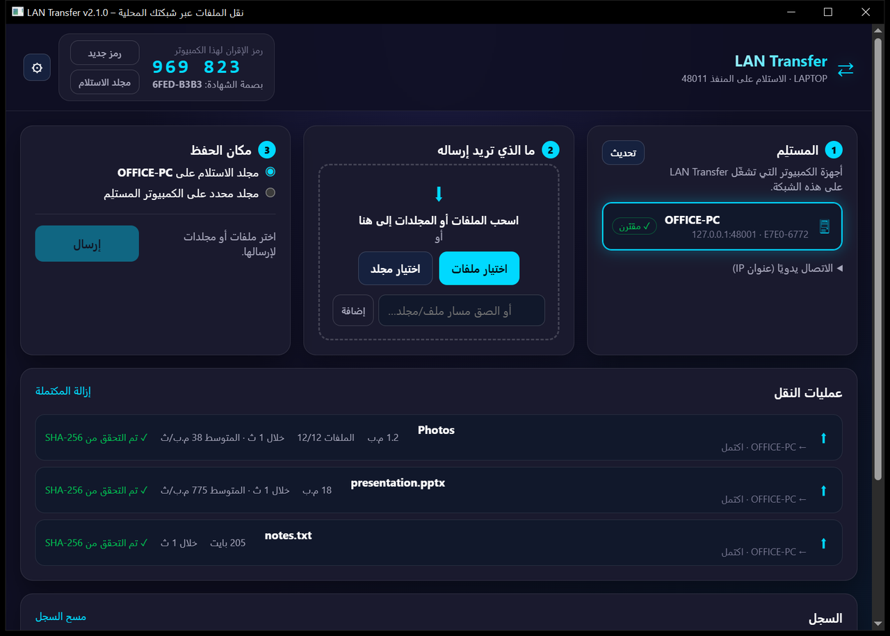
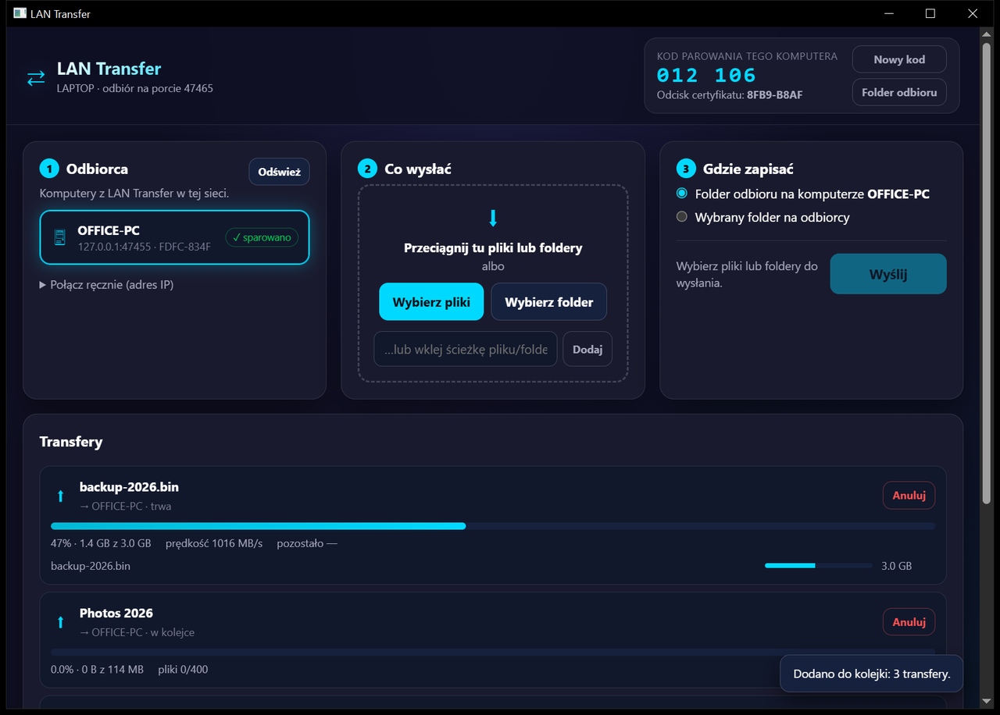

**Languages:** [English](../README.md) · [Polski](README.pl.md) · [Deutsch](README.de.md) · [Français](README.fr.md) · [Español](README.es.md) · [Italiano](README.it.md) · [Português](README.pt.md) · [Nederlands](README.nl.md) · [Svenska](README.sv.md) · [Norsk](README.no.md) · [Dansk](README.da.md) · [Suomi](README.fi.md) · [Čeština](README.cs.md) · [Slovenčina](README.sk.md) · [Magyar](README.hu.md) · [Română](README.ro.md) · [Türkçe](README.tr.md) · [Bahasa Indonesia](README.id.md) · [Bahasa Melayu](README.ms.md) · [Tiếng Việt](README.vi.md) · [Русский](README.ru.md) · [Українська](README.uk.md) · [Български](README.bg.md) · [Ελληνικά](README.el.md) · [العربية](README.ar.md) · [עברית](README.he.md) · [हिन्दी](README.hi.md) · [中文](README.zh.md) · [日本語](README.ja.md) · [한국어](README.ko.md)

# LAN Transfer

[](https://github.com/snakex21/LAN-Transfer/actions/workflows/ci.yml) [](https://github.com/snakex21/LAN-Transfer/releases/latest) [](../LICENSE) [](../go.mod) [](#pobieranie-i-uruchomienie)

Małe, przenośne narzędzie do przesyłania plików i folderów bezpośrednio między dwoma komputerami w tej samej sieci lokalnej. Bez chmury, bez konta i bez serwera pośredniczącego: dane trafiają prosto z jednego komputera na drugi przez szyfrowane połączenie. Rdzeń napisany w Go, okno WebView2 oraz wersja wiersza poleceń do skryptów.


## Spis treści

- [Funkcje](#funkcje)
- [Język interfejsu](#język-interfejsu)
- [Zrzuty ekranu](#zrzuty-ekranu)
- [Pobieranie i uruchomienie](#pobieranie-i-uruchomienie)
- [Jak sparować](#jak-sparować)
- [Wysyłanie plików](#wysyłanie-plików)
- [Wiersz poleceń](#wiersz-poleceń)
- [Porty i zapora](#porty-i-zapora)
- [Uwagi dotyczące bezpieczeństwa](#uwagi-dotyczące-bezpieczeństwa)
- [Zmienne środowiskowe](#zmienne-środowiskowe)
- [Budowanie i testy](#budowanie-i-testy)
- [Licencja](#licencja)

## Funkcje

- Automatyczne wykrywanie innych komputerów z uruchomionym LAN Transfer (rozgłoszenia UDP, a awaryjnie skanowanie podsieci /24 z ograniczonym tempem).
- Parowanie za pomocą 6-cyfrowego kodu wyświetlanego na odbiorcy. Bez sparowania nie można niczego wysłać ani przeglądać folderów.
- Szyfrowanie TLS 1.3. Każde uruchomienie tworzy nowy certyfikat z podpisem własnym; jego odcisk jest przypinany podczas parowania i sprawdzany przy każdym połączeniu.
- Pliki i całe foldery, z zachowaniem struktury folderów i wysyłaniem do 4 plików równolegle.
- Wznawianie przerwanych transferów i weryfikacja SHA-256 każdego pliku.
- Niedokończone dane są przechowywane w ukrytym folderze `.lantransfer-partial`, dzięki czemu niekompletny plik nigdy nie pojawia się pod swoją docelową nazwą.
- Przy kolizji nazw powstaje `file (1).txt` lub `Folder (1)`; istniejące pliki nigdy nie są nadpisywane.
- Niebezpieczne nazwy są odrzucane (`..`, ścieżki bezwzględne, alternatywne strumienie danych `file:stream`, nazwy zarezerwowane, takie jak `CON`, `NUL`, `COM1`). Przed odbiorem sprawdzane jest wolne miejsce na dysku.
- Przeciąganie i upuszczanie z Eksploratora plików, kolejka z postępem każdego pliku, prędkością, pozostałym czasem, anulowaniem i wznawianiem oraz historia wysłanych i odebranych elementów.
- Wersja przenośna: jeden plik EXE, ustawienia i historia w folderze `data` obok niego.
- Okno, jego tytuł i komunikaty wiersza poleceń w 30 językach (tych samych co to README), wybieranych automatycznie według języka wyświetlania Windows; układ od prawej do lewej dla arabskiego i hebrajskiego.

## Język interfejsu

LAN Transfer mówi w tych samych 30 językach co to README. Przy pierwszym uruchomieniu używa języka wyświetlania Windows (pierwszego obsługiwanego języka z listy języków Windows); jeśli Windows używa języka spoza listy, interfejs jest po angielsku.

Aby go zmienić, kliknij przycisk z kołem zębatym (**Ustawienia**) w prawym górnym rogu i wybierz język. Okno, jego tytuł i wszystkie komunikaty zmieniają się od razu, a wybór jest zapisywany w `data\settings.json`. **Automatycznie (Windows)** ponownie dopasowuje język do Windows. Liczby, rozmiary, prędkości, daty i formy liczby mnogiej są zgodne z regułami wybranego języka; arabski i hebrajski mają lustrzany układ od prawej do lewej, a ścieżki, adresy IP, kody i odciski certyfikatów pozostają zapisane od lewej do prawej. Komunikaty z drugiego komputera (na przykład „za mało miejsca na dysku odbiorcy”) są wyświetlane w Twoim języku, a nie w języku odbiorcy.

`LANTransferCLI.exe` używa tego samego języka. Zmienna `LANTRANSFER_LANG` (na przykład `LANTRANSFER_LANG=de`) ma pierwszeństwo przed zapisanym wyborem zarówno w oknie, jak i w wierszu poleceń.

| English | Deutsch | العربية (RTL) |
|---|---|---|
|  |  |  |

## Zrzuty ekranu

| Parowanie | Wysyłanie z postępem |
|---|---|
|  |  |
| **Wznowienie po anulowaniu** | **Odbiorca: historia** |
|  |  |

## Pobieranie i uruchomienie

1. Pobierz `LANTransfer-2.1.0-windows-amd64.zip` z [Releases](https://github.com/snakex21/LAN-Transfer/releases/latest) i sprawdź go z opublikowanym plikiem `.sha256`.
2. Rozpakuj archiwum do dowolnego folderu na obu komputerach.
3. Uruchom `LANTransfer.exe`. Przy pierwszym uruchomieniu Windows prosi (UAC) o zgodę na dodanie dwóch reguł zapory; zobacz [Porty i zapora](#porty-i-zapora).

Wymagania: Windows 10 lub 11 (64-bitowy) ze środowiskiem uruchomieniowym WebView2, które jest częścią aktualnych wersji Windows. Na obu komputerach musi działać wersja 2. Wersja 2 nie może komunikować się z wersją 1.

## Jak sparować

1. Uruchom LAN Transfer na obu komputerach. Odbiorca pokazuje swój kod parowania i odcisk certyfikatu w prawym górnym rogu.
2. Na komputerze wysyłającym kliknij odbiorcę na liście **Odbiorca**. Jeśli go tam nie ma, użyj **Połącz ręcznie (adres IP)** i wpisz jego adres IP.
3. Wpisz 6-cyfrowy kod z ekranu odbiorcy i porównaj odcisk certyfikatu pokazany w oknie dialogowym z odciskiem na odbiorcy. Jeśli się różnią, nie kontynuuj.
4. Kliknij **Sparuj**. Urządzenie ma teraz status **✓ sparowano**.

Po 5 błędnych kodach z jednego komputera odbiorca blokuje kolejne próby z tego komputera. **Nowy kod** tworzy nowy kod i anuluje wszystkie istniejące parowania. Odbiorca tworzy nowy kod i certyfikat przy każdym uruchomieniu, więc po ponownym uruchomieniu odbiorcy trzeba sparować urządzenia od nowa.

## Wysyłanie plików

1. Sparuj się z odbiorcą.
2. Przeciągnij pliki lub foldery na okno, użyj **Wybierz pliki** / **Wybierz folder** albo wklej ścieżkę.
3. Wybierz miejsce docelowe: domyślny folder odbiorcy (`Downloads\LAN Transfer`) lub inny istniejący folder na odbiorcy.
4. Kliknij **Wyślij**. Każdy element pokazuje postęp, prędkość i pozostały czas, a jego wysyłanie można anulować. Anulowany lub przerwany transfer można wznowić; wysyłana jest tylko brakująca część.

## Wiersz poleceń

`LANTransferCLI.exe` to ten sam program bez okna, przeznaczony do skryptów i automatyzacji.

```powershell
LANTransferCLI.exe serve                          # receive; prints the pairing code
LANTransferCLI.exe devices                        # list devices (JSON)
LANTransferCLI.exe send file.zip folder --to 192.168.0.15 --code 123456 [--dest D:\Inbox] [--parallel 4] [--json]
LANTransferCLI.exe version
```

Kod można też przekazać w zmiennej `LANTRANSFER_CODE`. Odbiorca bez okna może używać stałego kodu ze zmiennej `LANTRANSFER_PIN`. Ponowne uruchomienie tego samego polecenia `send` wznawia przerwany transfer.

## Porty i zapora

- UDP 45454: wykrywanie. TCP 45455: transfer (HTTPS).
- Przy pierwszym uruchomieniu aplikacja jednorazowo prosi (UAC) o dodanie dwóch reguł ruchu przychodzącego: `LAN Transfer 2 Discovery (UDP)` i `LAN Transfer 2 Transfer (TCP)`.
- Reguły przyjmują połączenia wyłącznie z podsieci lokalnej (`remoteip=LocalSubnet`) i wyłącznie w profilach sieci prywatnej i domenowej (`profile=private,domain`). W sieci, którą Windows oznacza jako publiczną (kawiarnia, hotel, lotnisko), inne komputery nie mogą połączyć się z LAN Transfer.
- Jeśli odbiorca nie jest widoczny w Twojej sieci domowej, sprawdź w ustawieniach sieci Windows, czy sieć jest ustawiona jako prywatna.
- Wersja 1 tworzyła reguły o nazwach `LAN Transfer Discovery` i `LAN Transfer Transfer` dla wszystkich profili, łącznie z publicznym. Jeśli wersja 2 je wykryje, wyświetla baner z propozycją ich zastąpienia. Nic nie zostanie zmienione, dopóki nie klikniesz **Zaktualizuj reguły** i nie potwierdzisz monitu Windows.

## Uwagi dotyczące bezpieczeństwa

- Wykrywanie przez UDP nie jest uwierzytelniane; służy wyłącznie jako podpowiedź. Zaufanie wynika z parowania: kodu oraz przypiętego odcisku certyfikatu.
- Podczas pierwszego parowania aktywny atakujący w tej samej sieci (atak typu man in the middle) mógłby podszyć się pod odbiorcę. Przed sparowaniem porównaj odcisk certyfikatu na obu ekranach.
- Sparowany nadawca może przeglądać foldery odbiorcy i zapisywać pliki w dowolnym istniejącym tam folderze (opcja własnego miejsca docelowego). Paruj tylko komputery, którym ufasz, a wszystkie parowania odwołasz przyciskiem **Nowy kod**.
- Reguły zapory nie otwierają portów w sieciach oznaczonych jako publiczne.

## Zmienne środowiskowe

Są przeznaczone do testów i automatyzacji; przy normalnym użytkowaniu żadna z nich nie jest potrzebna.

| Zmienna | Znaczenie |
|---|---|
| `LANTRANSFER_PORT`, `LANTRANSFER_UDP_PORT` | inne porty |
| `LANTRANSFER_RECEIVE_DIR`, `LANTRANSFER_DATA_DIR` | folder odbioru, folder danych programu |
| `LANTRANSFER_NAME` | nazwa komputera widoczna dla innych |
| `LANTRANSFER_LANG` | język interfejsu i wiersza poleceń (`en`, `de`, `pl`, …); ma pierwszeństwo przed zapisanym wyborem |
| `LANTRANSFER_LOOPBACK=1` | tylko 127.0.0.1: bez rozgłoszeń, bez skanowania LAN, bez reguł zapory |
| `LANTRANSFER_PEER_UDP_PORTS` | porty UDP innych instancji w trybie loopback |
| `LANTRANSFER_NO_FIREWALL=1` | nie twórz ani nie sprawdzaj reguł zapory |
| `LANTRANSFER_PIN`, `LANTRANSFER_CODE` | stały kod odbiorcy, kod używany przez nadawcę |

## Budowanie i testy

Go 1.23 lub nowszy w systemie Windows 10/11.

```powershell
build.bat
go test ./...
python tools/check_i18n.py
```

`build.bat` uruchamia testy i buduje `LANTransfer.exe` (wersja z oknem) oraz `LANTransferCLI.exe` (wersja konsolowa) z numerem wersji z pliku `VERSION` (domyślnie `2.1.0`). Testy obejmują pełne transfery przez 127.0.0.1: parowanie i blokadę, odrzucanie nieuwierzytelnionych żądań, pliki od 0 B do 96 MB, foldery z nazwami Unicode i ścieżki dłuższe niż 260 znaków, kolizje nazw, złośliwe nazwy, błędną sumę kontrolną, anulowanie i wznawianie, zapełniony dysk oraz przypinanie certyfikatu.

Tłumaczenia znajdują się w plikach `locales/ui.<code>.json` (polski jest językiem źródłowym, angielski zapasowym). `tools/check_i18n.py` sprawdza, czy wszystkie 30 plików ma te same klucze, placeholdery i formy liczby mnogiej oraz nie zawiera pozostałości polskiego tekstu; test Go sprawdza, czy każdy klucz używany przez program istnieje w każdym języku.

Informacje o wydaniu: [docs/releases/v2.1.0.md](../docs/releases/v2.1.0.md) · [v2.0.0](../docs/releases/v2.0.0.md).

## Licencja

MIT, zobacz [LICENSE](../LICENSE).
