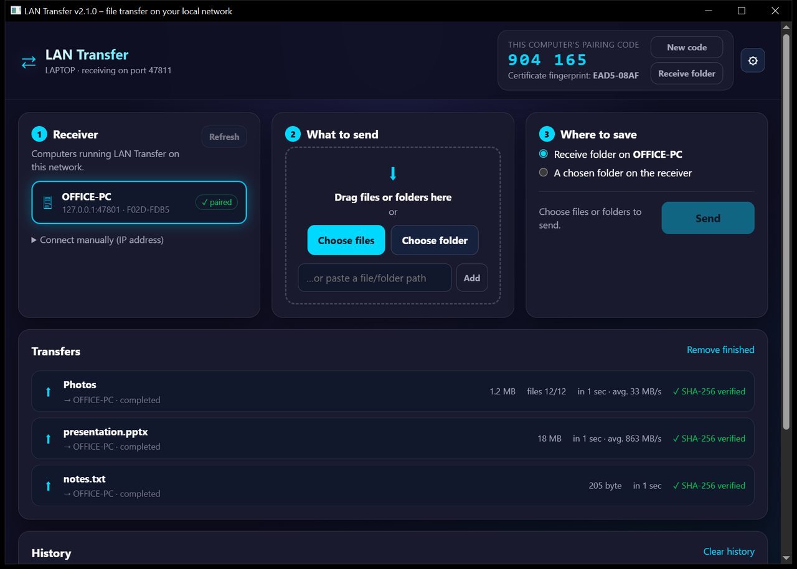

**Languages:** [English](../README.md) · [Polski](README.pl.md) · [Deutsch](README.de.md) · [Français](README.fr.md) · [Español](README.es.md) · [Italiano](README.it.md) · [Português](README.pt.md) · [Nederlands](README.nl.md) · [Svenska](README.sv.md) · [Norsk](README.no.md) · [Dansk](README.da.md) · [Suomi](README.fi.md) · [Čeština](README.cs.md) · [Slovenčina](README.sk.md) · [Magyar](README.hu.md) · [Română](README.ro.md) · [Türkçe](README.tr.md) · [Bahasa Indonesia](README.id.md) · [Bahasa Melayu](README.ms.md) · [Tiếng Việt](README.vi.md) · [Русский](README.ru.md) · [Українська](README.uk.md) · [Български](README.bg.md) · [Ελληνικά](README.el.md) · [العربية](README.ar.md) · [עברית](README.he.md) · [हिन्दी](README.hi.md) · [中文](README.zh.md) · [日本語](README.ja.md) · [한국어](README.ko.md)

# LAN Transfer

[](https://github.com/snakex21/LAN-Transfer/actions/workflows/ci.yml) [](https://github.com/snakex21/LAN-Transfer/releases/latest) [](../LICENSE) [](../go.mod) [](#stiahnutie-a-spustenie)

Malý prenosný nástroj na posielanie súborov a priečinkov priamo medzi dvoma počítačmi v tej istej lokálnej sieti. Bez cloudu, bez účtu a bez sprostredkujúceho servera: dáta idú priamo z jedného PC do druhého cez šifrované spojenie. Jadro v jazyku Go, okno WebView2 a verzia pre príkazový riadok na skripty.


## Obsah

- [Funkcie](#funkcie)
- [Jazyk rozhrania](#jazyk-rozhrania)
- [Snímky obrazovky](#snímky-obrazovky)
- [Stiahnutie a spustenie](#stiahnutie-a-spustenie)
- [Ako spárovať](#ako-spárovať)
- [Odosielanie súborov](#odosielanie-súborov)
- [Príkazový riadok](#príkazový-riadok)
- [Porty a firewall](#porty-a-firewall)
- [Bezpečnostné poznámky](#bezpečnostné-poznámky)
- [Premenné prostredia](#premenné-prostredia)
- [Zostavenie a testy](#zostavenie-a-testy)
- [Licencia](#licencia)

## Funkcie

- Automatické vyhľadávanie ďalších počítačov so spusteným LAN Transfer (UDP broadcast a ako záloha spomalené skenovanie /24).
- Párovanie pomocou 6-miestneho kódu zobrazeného na príjemcovi. Bez spárovania nie je možné nič odoslať ani prehliadať priečinky.
- Voliteľný režim bez kódu: na príjemcovi vypnite v Nastaveniach **Vyžadovať párovací kód** (uloží sa do `data\settings.json`) alebo spustite `serve --no-code`. Potom mu môže každý počítač s LAN Transfer v sieti posielať súbory bez kódu, stále šifrovane; hlavička medzitým ukazuje **Bez kódu**.
- Šifrovanie TLS 1.3. Pri každom spustení sa vytvorí nový certifikát podpísaný sám sebou; jeho odtlačok sa pri párovaní pripne a overuje sa pri každom pripojení.
- Súbory aj celé priečinky so zachovanou štruktúrou priečinkov a až 4 súbormi odosielanými paralelne.
- Obnovenie prerušených prenosov a kontrola SHA-256 každého súboru.
- Nedokončené dáta sa ukladajú do skrytého priečinka `.lantransfer-partial`, takže neúplný súbor sa nikdy neobjaví pod svojím konečným názvom.
- Pri kolízii názvov vznikne `file (1).txt` alebo `Folder (1)`; existujúce súbory sa nikdy neprepíšu.
- Nebezpečné názvy sa odmietajú (`..`, absolútne cesty, alternatívne dátové prúdy `file:stream`, rezervované názvy ako `CON`, `NUL`, `COM1`). Pred prijímaním sa overí voľné miesto na disku.
- Drag and drop z Prieskumníka, fronta s priebehom pre každý súbor, rýchlosťou, zostávajúcim časom, zrušením, obnovením a históriou odoslaných a prijatých položiek.
- Prenosná aplikácia: jediný súbor EXE, nastavenia a história v priečinku `data` vedľa neho.
- Okno, jeho titulok a výstup príkazového riadka v 30 jazykoch (rovnakých ako pri tomto README), vyberaných automaticky podľa jazyka zobrazenia systému Windows; rozloženie sprava doľava pre arabčinu a hebrejčinu.

## Jazyk rozhrania

LAN Transfer hovorí rovnakými 30 jazykmi ako tento README. Pri prvom spustení používa jazyk zobrazenia systému Windows (prvý podporovaný jazyk zo zoznamu jazykov Windows); ak Windows používa jazyk, ktorý v zozname nie je, rozhranie je v angličtine.

Jazyk zmeníte kliknutím na tlačidlo s ozubeným kolesom (**Nastavenie**) v pravom hornom rohu a výberom jazyka. Okno, jeho titulok aj všetky správy sa prepnú okamžite a výber sa uloží do `data\settings.json`. Možnosť **Automaticky (Windows)** znova nastaví jazyk podľa jazyka zobrazenia systému Windows. Čísla, veľkosti, rýchlosti, dátumy a tvary množného čísla sa riadia pravidlami zvoleného jazyka; arabčina a hebrejčina používajú zrkadlové rozloženie sprava doľava, pričom cesty, IP adresy, kódy a odtlačky zostávajú zľava doprava. Správy z druhého počítača (napríklad „na disku príjemcu nie je dosť miesta“) sa zobrazujú vo vašom jazyku, nie v jazyku príjemcu.

`LANTransferCLI.exe` používa rovnaký jazyk. `LANTRANSFER_LANG` (napríklad `LANTRANSFER_LANG=de`) má prednosť pred uloženým výberom v okne aj v príkazovom riadku.

| English | Deutsch | العربية (RTL) |
|---|---|---|
|  |  |  |

## Snímky obrazovky

| Párovanie | Odosielanie s priebehom |
|---|---|
|  |  |
| **Obnovenie po zrušení** | **Príjemca: história** |
|  |  |

## Stiahnutie a spustenie

1. Stiahnite `LANTransfer-2.1.0-windows-amd64.zip` zo stránky [Releases](https://github.com/snakex21/LAN-Transfer/releases/latest) a overte ho podľa zverejneného súboru `.sha256`.
2. Rozbaľte ho do ľubovoľného priečinka na oboch počítačoch.
3. Spustite `LANTransfer.exe`. Pri prvom spustení Windows požiada (UAC) o povolenie pridať dve pravidlá brány firewall; pozrite [Porty a firewall](#porty-a-firewall).

Požiadavky: Windows 10 alebo 11 (64-bit) s prostredím WebView2 runtime, ktoré je súčasťou aktuálnych verzií Windows. Na oboch počítačoch musí bežať verzia 2. Verzia 2 nedokáže komunikovať s verziou 1.

## Ako spárovať

1. Spustite LAN Transfer na oboch počítačoch. Príjemca zobrazuje svoj párovací kód a odtlačok certifikátu v pravom hornom rohu.
2. Na odosielajúcom počítači kliknite na príjemcu v zozname **Príjemca**. Ak sa v ňom nezobrazí, použite **Pripojiť manuálne (IP adresa)** a zadajte jeho IP adresu.
3. Zadajte 6-miestny kód z obrazovky príjemcu a porovnajte odtlačok certifikátu zobrazený v dialógu s odtlačkom na príjemcovi. Ak sa líšia, nepokračujte.
4. Kliknite na **Spárovať**. Zariadenie teraz ukazuje stav **✓ spárované**.

Po 5 nesprávnych kódoch z jedného počítača príjemca zablokuje ďalšie pokusy z tohto počítača. **Nový kód** vytvorí nový kód a zruší všetky existujúce spárovania. Príjemca pri každom spustení vytvára nový kód a certifikát, takže po jeho reštarte je potrebné spárovať znova.

## Odosielanie súborov

1. Spárujte sa s príjemcom.
2. Presuňte súbory alebo priečinky do okna, použite **Vybrať súbory** / **Vybrať priečinok** alebo vložte cestu.
3. Zvoľte cieľ: predvolený priečinok príjemcu (`Downloads\LAN Transfer`) alebo iný existujúci priečinok na príjemcovi.
4. Kliknite na **Odoslať**. Každá položka zobrazuje priebeh, rýchlosť a zostávajúci čas a dá sa zrušiť. Zrušený alebo prerušený prenos je možné obnoviť; odošle sa len chýbajúca časť.

## Príkazový riadok

`LANTransferCLI.exe` je ten istý program bez okna, určený na skripty a automatizáciu.

```powershell
LANTransferCLI.exe serve                          # receive; prints the pairing code
LANTransferCLI.exe devices                        # list devices (JSON)
LANTransferCLI.exe send file.zip folder --to 192.168.0.15 --code 123456 [--dest D:\Inbox] [--parallel 4] [--json]
LANTransferCLI.exe version
```

Kód možno odovzdať aj v premennej `LANTRANSFER_CODE`. Príjemca bez okna môže používať pevný kód z `LANTRANSFER_PIN`. Opätovné spustenie toho istého príkazu `send` obnoví prerušený prenos.

## Porty a firewall

- UDP 45454: vyhľadávanie. TCP 45455: prenos (HTTPS).
- Pri prvom spustení aplikácia raz požiada (UAC) o pridanie dvoch pravidiel pre prichádzajúcu komunikáciu: `LAN Transfer 2 Discovery (UDP)` a `LAN Transfer 2 Transfer (TCP)`.
- Pravidlá prijímajú spojenia iba z lokálnej podsiete (`remoteip=LocalSubnet`) a iba v sieťových profiloch Súkromná a Doména (`profile=private,domain`). V sieti, ktorú Windows označí ako Verejná (kaviareň, hotel, letisko), sa ostatné počítače k LAN Transfer nepripoja.
- Ak príjemca nie je viditeľný vo vašej domácej sieti, skontrolujte, či je sieť v nastaveniach siete Windows nastavená ako Súkromná.
- Verzia 1 vytvárala pravidlá s názvami `LAN Transfer Discovery` a `LAN Transfer Transfer` pre všetky profily vrátane profilu Verejná. Ak ich verzia 2 nájde, zobrazí pruh s ponukou na ich nahradenie. Nič sa nezmení, kým nekliknete na **Aktualizovať pravidlá** a nepotvrdíte výzvu systému Windows.

## Bezpečnostné poznámky

- Vyhľadávanie cez UDP nie je overované; slúži iba ako nápoveda. Dôvera vychádza z párovania: kód spolu s pripnutým odtlačkom certifikátu.
- Počas prvého párovania by sa aktívny útočník v tej istej sieti (man in the middle) mohol vydávať za príjemcu. Pred spárovaním porovnajte odtlačok certifikátu na oboch obrazovkách.
- Spárovaný odosielateľ môže prehliadať priečinky príjemcu a ukladať súbory do ľubovoľného existujúceho priečinka na ňom (možnosť vlastného cieľa). Spárujte iba počítače, ktorým dôverujete, a na zrušenie všetkých spárovaní použite **Nový kód**.
- Pravidlá brány firewall neotvárajú porty v sieťach označených ako Verejná.
- Pri vypnutom **Vyžadovať párovací kód** môže ktokoľvek v sieti s LAN Transfer posielať súbory do tohto počítača a prehliadať jeho priečinky bez kódu, ako vo verzii 1 (ale šifrovane). Používajte to len v dôveryhodnej sieti. Opätovné zapnutie kódu odpojí odosielateľov pripojených bez neho.

## Premenné prostredia

Sú určené na testy a automatizáciu; pri bežnom používaní nie je potrebná žiadna z nich.

| Premenná | Význam |
|---|---|
| `LANTRANSFER_PORT`, `LANTRANSFER_UDP_PORT` | iné porty |
| `LANTRANSFER_RECEIVE_DIR`, `LANTRANSFER_DATA_DIR` | priečinok na prijímanie, priečinok s dátami programu |
| `LANTRANSFER_NAME` | názov počítača zobrazovaný ostatným |
| `LANTRANSFER_LANG` | jazyk rozhrania a príkazového riadka (`en`, `de`, `pl`, …); má prednosť pred uloženým výberom |
| `LANTRANSFER_LOOPBACK=1` | iba 127.0.0.1: žiadne broadcasty, žiadne skenovanie LAN, žiadne pravidlá brány firewall |
| `LANTRANSFER_PEER_UDP_PORTS` | UDP porty ďalších inštancií v režime loopback |
| `LANTRANSFER_NO_FIREWALL=1` | nevytvárať ani nekontrolovať pravidlá brány firewall |
| `LANTRANSFER_PIN`, `LANTRANSFER_CODE` | pevný kód príjemcu, kód používaný odosielateľom |
| `LANTRANSFER_REQUIRE_CODE=0` | `0` = tento príjemca nevyžaduje párovací kód, `1` = kód vyžadovaný; má prednosť pred nastavením |

## Zostavenie a testy

Go 1.23 alebo novší na Windows 10/11.

```powershell
build.bat
go test ./...
python tools/check_i18n.py
```

`build.bat` spustí testy a zostaví `LANTransfer.exe` (okno) a `LANTransferCLI.exe` (konzola) s verziou zo súboru `VERSION` (predvolene `2.1.0`). Testy zahŕňajú end-to-end prenosy cez 127.0.0.1: párovanie a blokovanie, odmietnutie neoverených požiadaviek, súbory od 0 B do 96 MB, priečinky s názvami v Unicode a cesty dlhšie ako 260 znakov, kolízie názvov, škodlivé názvy, nesprávny kontrolný súčet, zrušenie a obnovenie, plný disk a pripínanie certifikátu.

Preklady sú v súboroch `locales/ui.<code>.json` (zdrojovým jazykom je poľština, záložným angličtina). `tools/check_i18n.py` kontroluje, či všetkých 30 súborov má rovnaké kľúče, zástupné symboly a tvary množného čísla a či neobsahuje zvyšky poľského textu; test v Go overuje, či každý kľúč používaný programom existuje vo všetkých jazykoch.

Poznámky k vydaniu: [docs/releases/v2.1.0.md](../docs/releases/v2.1.0.md) · [v2.0.0](../docs/releases/v2.0.0.md).

## Licencia

MIT, pozrite [LICENSE](../LICENSE).
